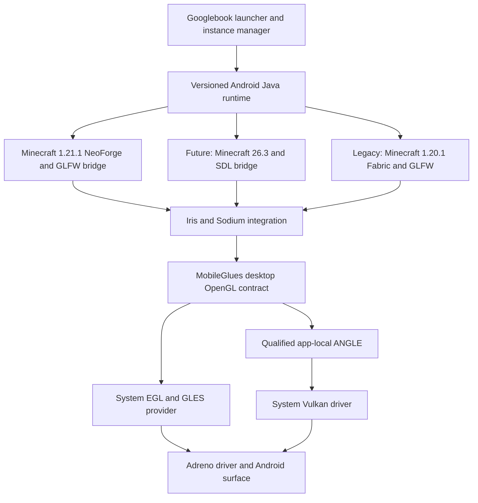

# MobileGlues for Googlebook architecture and product requirements

Research date: 19 October 2026. Target: native Android ARM64 on Snapdragon X1E and X2E Googlebooks. This is an engineering specification; hardware compatibility and performance remain to be qualified.

Read this file for the product and architecture, `02_MobileGlues_Googlebook_Implementation_Plan.md` for execution stages, and `03_MobileGlues_Googlebook_Validation_and_Sources.md` for acceptance tests, evidence, and operating rules.

## 1. Product decision

Build a Googlebook-specific distribution of MobileGlues together with one maintained launcher integration and a tested Minecraft runtime matrix. The deliverable is the experience of installing a supported instance, importing an original shaderpack ZIP, selecting its normal settings, and playing with the intended effects.

MobileGlues is the desktop OpenGL compatibility component. A complete product also owns Android native loading, the Java runtime, Minecraft's version-specific windowing bridge, Iris and Sodium compatibility, provider selection, desktop input, recovery, and diagnostic collection. A renderer library alone cannot make these dependencies work automatically.

The primary implementation is a focused fork of MobileGlues with separable upstream fixes and Googlebook policies. Evaluate the limits of GLES immediately. If an essential shader feature cannot be represented correctly through any production-accessible GLES provider, retain that requirement and make an explicit renderer architecture decision. Do not redefine a missing effect as supported.

### The expected user journey

1. Install the supported launcher package and complete normal Minecraft account sign-in.
2. Select a supported Minecraft instance. The launcher resolves the exact Java runtime, native libraries, loader, Iris, Sodium, and renderer versions together.
3. Import a shaderpack ZIP through the Files app, drag and drop, or the shaderpack screen.
4. Select the pack's own preset. Show any project-recommended starting preset by its exact name.
5. Play. Provider selection, compatibility policy, shader caching, and ordinary recovery work automatically.
6. If the selected combination cannot run, identify the failed requirement and offer a tested configuration. Keep the original ZIP and the user's options intact.

For a certified configuration, users should not need shader source edits, driver ZIP hunting, environment-variable recipes, debug graphics settings, root, or a Linux VM. These are release criteria for the normal installation path.

### What full support means

A pack is supported only for an identified version, settings profile, runtime, renderer build, and device/driver combination. All enabled passes and requested effects must execute correctly. A successful compile, attractive screenshot, or average FPS result alone does not establish support.

The primary goal is standard desktop OpenGL behavior through MobileGlues: ordinary shaderpack ZIPs must work out of the box with their intended effects, with performance secondary to correctness. The project should support an expanding range of ordinary packs through general OpenGL and GLSL behavior, not per-pack rewrites.

The 1.0 completion gate requires the standard pack corpus plus the specified advanced Complementary coverage: Very High with ACT 192 and the custom WSR 128 profile (ACT 128, world-space reflections on). The author Ultra profile (ACT 256/WSR 256) is **not** an X1E release criterion; it remains optional/future X2E work and stays `BLOCKED` on X1E by the provider's 134,217,728-byte shader-storage-block limit. The ACT 512 stress profile is likewise optional. Intermediate standard-shader releases remain useful and must be labeled with that narrower scope.

Keep three ratings separate: visual correctness, stability, and performance. A correctly rendered advanced preset that runs slowly is a performance failure for that preset, not evidence of a translator defect. A fast run with an omitted effect is a correctness failure.

## 2. Hardware and platform scope

Use the XPS Googlebook with Snapdragon X1E-80-100 as the initial reference device. Google lists Googlebook OS, 16 GB RAM, a 2560 × 1600 panel, and 30–120 Hz variable refresh for this exact model. Other X1E models join through the same qualification process. [S01](https://store.google.com/us/product/xps_googlebook_specs?hl=en-US)

Treat X2E as a separate required qualification track. X2-85 and X2-90 are distinct GPU variants in current upstream Mesa records. Each exact SoC, OEM configuration, OS build, graphics driver, and provider needs its own result. Product-family API claims do not substitute for a shipping Android driver report. [S02](https://docs.mesa3d.org/relnotes/26.2.0.html)

Run the game and renderer in the Android host application process. Google's October 12 Terminal preview still places GPU/NPU acceleration on the Linux VM roadmap. The VM may assist development, but the supported game path must stand on its own. [S03](https://developer.android.com/blog/posts/googlebook-linux-terminal-preview-vm?hl=en)

Use one ARM64 baseline binary when possible. Compile additional CPU-specific paths only when runtime feature detection and measured benefit justify them. Do not infer GPU compiler behavior from CPU instruction support, or use the build machine's native CPU settings for release artifacts.

A device profile includes:

- OEM and product model, exact SoC, Android SDK and build fingerprint.
- GPU identity, GLES/EGL provider, graphics driver identity, and Vulkan identifiers where exposed.
- Launcher, Java runtime, native bridge, MobileGlues, and optional ANGLE/Mesa build identities.
- Actual system page size and memory conditions.
- Validated capability/format report, policy revision, and qualification status.

Unknown devices start with conservative, truthful capabilities and an unqualified status. They do not inherit a certified X1E profile merely because the renderer string contains Adreno.

## 3. Current software baseline

| Component | Evidence available on 19 October 2026 | Engineering consequence |
| --- | --- | --- |
| MobileGlues public release | V2.0.0; the release includes launcher-provided ANGLE integration and multidraw benchmarking | Preserve these facilities and strengthen their qualification |
| Core source audit | `97558a69157b033b890958b1e49258c5b51a80c6`, dated 22 September 2026 | Reproduce source findings before treating them as device failures |
| Plugin source | `f5105e4ddd1752cccdcc6421c402960d40ec3d9d`; core submodule `f56af31d3e490d95808b3adc4ace20234249a37a` | The release source and newer core main are different baselines |
| Current delivery lane | Minecraft 1.21.1 on NeoForge 21.1.262 with Java 21 (`java-runtime-delta`) and LWJGL 3.3.3 GLFW; Iris 1.8.14-beta.1 and Sodium 0.8.13 NeoForge builds. NeoForge 21.1.264 is an optional future patch, not a blocker | This is the lane ordinary shaderpack ZIPs must work in. The 21.1.262 tuple is staged/working; effect fidelity, performance, lifecycle and remaining Android native-closure work are the release blockers |
| Delivery-lane fallback | Iris 1.8.12 NeoForge requires Sodium 0.6.13 NeoForge; it must never be paired with Sodium 0.8.13 | Keep a pinned, tested fallback pair rather than mixing versions |
| Future/experimental lane | Minecraft 26.3 uses Java 25 and LWJGL 3.4.3 with SDL, ShaderC and SPIRV-Cross modules | Neither required nor qualified; a GLFW-only bridge is still insufficient for it |
| Legacy modded lane | Minecraft 1.20.1 with an explicitly matched Fabric/Iris/Sodium stack | Retain a distinct compatibility and regression lane |
| Complementary | Published r5.9.3 is the main project qualification target; retain r5.9.2 for regression | Pin original release assets, not only repository HEAD |
| Sodium support | Upstream excludes OpenGL translation layers from its supported configurations | This project owns its tested compatibility and downstream fixes |

Sources: [MobileGlues release](https://github.com/MobileGL-Dev/MobileGlues-release/releases/tag/V2.0.0), [core snapshot](https://github.com/MobileGL-Dev/MobileGlues/tree/97558a69157b033b890958b1e49258c5b51a80c6), [Minecraft 1.21.1 manifest](https://piston-meta.mojang.com/v1/packages/499680d659b7a0ccb2fa9a809c345c5baf2ace7d/1.21.1.json), [NeoForge 21.1.262 installer](https://maven.neoforged.net/releases/net/neoforged/neoforge/21.1.262/neoforge-21.1.262-installer.jar), [NeoForge 21.1.264 installer (optional future patch)](https://maven.neoforged.net/releases/net/neoforged/neoforge/21.1.264/neoforge-21.1.264-installer.jar), [Minecraft 26.3 manifest](https://piston-meta.mojang.com/v1/packages/11f1aefe473eefba0af62e3286c33b692807b2eb/26.3.json), [Complementary releases](https://modrinth.com/shader/complementary-reimagined/versions), [Sodium policy](https://github.com/CaffeineMC/sodium).

The version matrix in the validation document is a starting lock proposal, not a statement that these builds already work on Googlebook. The supported X1E target is the installed 1.21.1 / NeoForge 21.1.262 / Iris 1.8.14-beta.1 / Sodium 0.8.13 tuple, which is staged and working up to the recorded world/title pass. NeoForge 21.1.264 is an optional future patch: it is not a delivery target and not a release blocker. Effect fidelity, performance and lifecycle gates remain open. Resolve every remaining dependency and asset hash in Stage 0.

## 4. Architecture and ownership

Each process chooses one coherent provider path. The diagram does not authorize mixing contexts or resources between providers.

| Layer | Owns | Must not silently assume |
| --- | --- | --- |
| Launcher | Entitled game installation, dependency lock, native loading, provider policy, instance files, safe restart and support export | A renderer plugin alone supplies a working JVM or modern engine bridge |
| Version-specific bridge | SDL or GLFW adaptation, native window/EGL creation, function resolution, input and size events | Desktop Linux ARM64 native libraries work with Android Bionic |
| Iris integration | Pack includes and options, custom uniforms, pass schedule, targets, compute programs, feature requests and history lifecycle | Every pack program reaches `glShaderSource` in every engine version |
| MobileGlues | Desktop GL state and API semantics, GLSL lowering, resource mapping, validation, frontend diagnostics | A valid pointer or extension string proves an implementation |
| GLES provider | Actual ES implementation and compilation, context/surface operations | ANGLE request equals ANGLE selection |
| Device policy | Tested backend choices and specific driver workarounds | X2E is an X1E performance preset |
| Qualification tools | Reproducible scenes, capability probes, differential rendering, performance and endurance reports | An emulator or desktop driver certifies retail Adreno behavior |

### The delivery lane requires its own bootstrap contract

The delivery lane is Minecraft 1.21.1 on NeoForge 21.1.262 with Java 21 (`java-runtime-delta`); NeoForge 21.1.264 is an optional future patch. Its manifest selects LWJGL 3.3.3 with the GLFW, OpenGL, OpenAL, STB, FreeType, jemalloc, JNA and tinyfd modules. It contains no Android-classifier native libraries, no SDL, no ShaderC and no RenderPearl/SDL function-provider contract. The launcher therefore provides the Android window/EGL surface and the desktop-GL bridge underneath an unmodified GLFW-era client. Stage 0 locks the Java 21 runtime and LWJGL 3.3.3 closure, proves baseline source reproducibility, and records missing Android components as owned blockers. Stage 1 builds and validates the loadable Android runtime closure through NeoForge startup and Iris/Sodium loading. [S06](https://piston-meta.mojang.com/v1/packages/499680d659b7a0ccb2fa9a809c345c5baf2ace7d/1.21.1.json)

In this lane, MobileGlues is reached through the launcher's native GL bridge: the game's LWJGL GL capability object must resolve its function pointers to the actual loadable MobileGlues frontend, and the launcher's EGL/GLES surface plus provider must be the one the game process uses. A function provider that supplies callbacks without the real library path is insufficient for desktop-equivalent behavior. Verify transformed entry points, not just `glGetError`. Reverify this contract per game and loader version.

Minecraft 26.2 introduced an experimental Vulkan option while retaining OpenGL; the preference setting can fall back. A future 26.3 lane changes shader compilation under OpenGL and, per inspected bytecode, casts `GL.getFunctionProvider()` to `org.lwjgl.system.SharedLibrary` and passes its `getPath()` to SDL, which must agree with LWJGL on `glGetError`. That artifact also confirms an OpenGL shader path using ShaderC and SPIRV-Cross outputting GLSL 330 before ordinary GL source/compile calls. This is retained as future-lane evidence only; it is neither required nor implemented in the delivery lane. [S04](https://www.minecraft.net/en-us/article/minecraft-java-edition-26-2) [S05](https://feedback.minecraft.net/hc/en-us/articles/48913133328013-Minecraft-Java-Edition-26-3)

The delivery lane's Iris 1.8.14-beta.1 NeoForge build is a beta, and its metadata points to Sodium 0.8.13 NeoForge. The stable fallback is Iris 1.8.12 NeoForge with Sodium 0.6.13 NeoForge; Iris 1.8.12 with Sodium 0.8.13 is an untested pair and must not be shipped. Inspect the exact selected binaries for loader, LWJGL, ABI and provider restrictions, maintain any necessary licensed downstream adaptation with distinct versions, hashes and diagnostics, and record which pair produced every result. The supported tuple is the installed NeoForge 21.1.262 instance with these mods, which is staged and working through a world load, render and save/quit pass. NeoForge 21.1.264 is an optional future patch with no run; it is not a release blocker.

Qualify Iris against the game's actual OpenGL backend in every lane. A Vulkan implementation underneath the GL frontend still presents the OpenGL contract to Minecraft/Iris; it does not establish support for any native Vulkan backend. Development-branch findings in the validation document are leads to recheck against the selected release.

## 5. Provider strategy

### Production candidates

1. **System EGL/GLES.** Record whether the observed provider is vendor GLES or system ANGLE. Android 17 allows the launcher application to request ANGLE in its manifest, but the request is only a preference. [S07](https://developer.android.com/games/develop/vulkan/overview)
2. **App-local ANGLE.** Qualify an explicitly packaged or launcher-supplied build with consistent EGL/GLES symbols, native dependencies, Android window handling, and release-mode loading.
3. **An alternative complete GL stack.** Evaluate only if required semantics or important driver defects prevent the GLES routes from meeting the product target.

Do not rank vendor GLES and ANGLE by reputation. Select from candidates that pass the same correctness suite, then compare sustained frame times, memory, startup behavior, and lifecycle reliability.

A separately installed development ANGLE APK selected through debug settings has debuggable-app/root restrictions. It is useful in the laboratory; it is not the ordinary installation mechanism. [S08](https://chromium.googlesource.com/angle/angle/+/main/doc/DevSetupAndroid.md)

### Provider boundaries

The provider owns its EGL display, contexts, surfaces, resource namespace, dispatch tables, and backend caches. Resolve required APIs through that provider consistently. Do not combine vendor EGL with a different provider's GLES entry points.

Choose the provider before graphics initialization. A provider change requires a clean graphics-session restart and, preferably, a fresh game process. Do not swap a live function table or continue with handles from the old provider.

Persist the observed provider, not just the requested option. If the system chooses a different provider after an OS update, invalidate relevant binary caches and rerun qualification.

### Early GLES feasibility gate

During the first hardware milestone, compare actual pack resource requirements with the production providers' limits and semantics. Check simultaneous samplers, SSBOs, image units, formats, atomics, workgroup limits, geometry/tessellation features, mapped-buffer behavior, and texture feedback.

If an essential requirement is missing:

- First determine whether a general, exact emulation is possible within acceptable cost.
- Run a bounded comparison of a pinned Zink build on the system Vulkan driver.
- Test Turnip only when its Android loading, kernel interface, allocation, and window integration are viable on the exact device.
- Record whether the problem belongs to MobileGlues, the GLES contract, the driver, or native packaging.

Allocate approximately two engineering weeks to the initial comparison. This answers feasibility questions; it does not certify a production alternative. Selecting another complete GL route requires a revised component lock, an implementation owner, renewed launcher/ABI/provider qualification, and the applicable S2–S9 gates on that actual route. Rebaseline effort after the decision; results from MobileGlues over GLES do not transfer automatically.

Current Mesa contains X1/X2 device work, so lack of any upstream X2 support is not a valid rejection. Conversely, chip support does not prove a retail Googlebook can load that driver. Zink also has detailed feature, format, and limit requirements beyond a Vulkan version number. [S02](https://docs.mesa3d.org/relnotes/26.2.0.html) [S09](https://docs.mesa3d.org/drivers/zink.html)

The separate MobileGL project is under development with independent GLES/Vulkan backends and a stated short-term GL 4.2 Core target. Observe its progress; do not treat it as the already-completed MobileGlues solution. [S10](https://github.com/MobileGL-Dev/MobileGL)

## 6. OpenGL implementation contract

Maintain a single per-context capability model, backed by provider probes and implementation tests. It drives context negotiation, version strings, extension enumeration, limits, function routing, shader lowering, and diagnostics.

**Capability coverage.** MobileGlues must expose a truthful desktop GL contract for ordinary packs: a core version it actually implements plus individually earned extensions. The contract covers GLSL translation and program/link state, framebuffer and render-target routing, texture/image and SSBO resource mapping, compute dispatch, and the barrier/fence/visibility semantics each advertised feature promises. A capability is advertised only when its complete required behavior is implemented and tested on the named provider. Unimplemented features remain named compatibility deviations and are never counted as claims; advertising a core version does not erase a deviation. This targets the contract ordinary shaderpacks use and does not promise full OpenGL 4.6 conformance.

On the supported X1E 1.21.1 / NeoForge 21.1.262 tuple, depth-texture filter completeness, 64-bit timestamp queries, same-format depth `glCopyImageSubData`, program/array image-unit routing, logical attachment invalidation after a draw-buffer shuffle, and multisample framebuffer resolve are implemented and tested. `glTextureBarrier`/NV and `glTextureView` remain named deviations; the pinned Iris/Sodium builds do not call them. The reported core version and GLSL level remain a truthful subset of the implementation, not a 4.6 conformance claim.

For each feature, store:

- Required frontend entry points and shader syntax.
- Provider requirements and applicable limits.
- Direct implementation or exact emulation strategy.
- Tests proving the semantics.
- Known driver exceptions and affected fingerprints.
- Release status.

Classify a feature as direct, exactly emulated, unavailable, or a named compatibility deviation. A deviation is not eligible for a full-fidelity claim.

The frontend may expose a callable stub for ABI reasons, but it must not turn that stub into a capability claim. Report failure consistently. Advertise a core version only after its entire required contract is implemented and verified; otherwise use the actual supported version and individually earned extensions.

Restore meaningful GL errors, shader and link status, and framebuffer status before qualifying packs. The audited main source suppresses errors and overstates a fragment-sampler limit. These are source findings, not hardware reproductions. [S11](https://github.com/MobileGL-Dev/MobileGlues/blob/97558a69157b033b890958b1e49258c5b51a80c6/MobileGlues-cpp/gl/getter.cpp)

### Shader and program state

Use share-group-owned shader/program objects, per-context binding state, and explicit link generations. Track attachments, requested fragment outputs, uniforms, storage blocks, original sources, translated sources, logs, and cache identities.

Implement `glShaderSource` count and length semantics before translation. Preserve program ownership during interleaved compilation, linking, deletion, and use from shared contexts. A one-element translated source array must be submitted with a count of one.

Extend the existing glslang and SPIRV-Cross pipeline rather than starting another text-replacement compiler. Exact lowering must preserve source locations, version/profile semantics, explicit bindings and locations, interpolation, integer types, block layouts, derivatives, texture operations, and memory qualifiers. Keep narrowly scoped pack workarounds separate from this path. [S12](https://github.com/KhronosGroup/glslang) [S13](https://github.com/KhronosGroup/SPIRV-Cross)

### SSBO binding on GLES

Shader storage buffer objects hold structured data that advanced effects may read and write. GLES does not offer a simple equivalent of every desktop rebinding call.

A design to implement and validate is:

1. Assign physical GLES storage slots while linking/lowering a program.
2. Preserve the desktop program-block-to-binding-point mapping.
3. Track indexed application buffer bindings, offsets, and ranges.
4. Update the logical mapping when the application calls `glShaderStorageBlockBinding`.
5. Prepare the physical bindings before every draw and compute dispatch.
6. Return logical desktop values from reflection queries.

Test shared buffers, aliasing, inactive blocks, range alignment, relinking, program switching, and `std430` layouts. Track generations for both shared program mappings and context binding state: a program-block mapping change in one context must invalidate another context's materialized state even without a local `glUseProgram` call. This indirection cannot exceed the provider's simultaneously active resource limits.

### Images, framebuffers and synchronization

Use one format table for each operation: allocation, upload, sampling, filtering, rendering, blending, image access, atomics, clearing, copying, and readback. Treat integer/normalized/float representations and depth precision distinctly. A substitute format requires a semantics proof and tests for each exposed usage.

Retain MobileGlues' existing framebuffer attachment routing, then validate sparse draw lists, output remapping, indexed clears/blending, depth-only passes, layers, multisampling, and read-buffer behavior.

Compute and barrier forwarding already exist in MobileGlues. Complete their resource state, clearing, binding, and visibility contracts. Keep API memory barriers, shader barriers, CPU/GPU fences, and texture-feedback synchronization distinct. `glFinish` cannot legalize a framebuffer/texture feedback pattern that is undefined in GLES or automatically substitute for desktop `glTextureBarrier`. Qualify an equivalent provider feature or an exact, explicitly restricted emulation.

Persistent mapping needs correct explicit flush behavior, coherent visibility when promised, CPU/GPU ownership, and fence-safe reuse. Unified memory does not establish these semantics automatically.

## 7. Shaderpack scope

| Qualification level | Required workload | Completion criterion |
| --- | --- | --- |
| Base rendering | Vanilla, Sodium, deterministic diagnostic packs | Correct geometry, state, targets, input and presentation |
| Standard packs | Complementary Reimagined/Unbound and BSL at pinned normal presets | All selected shadows, lighting, water, SSR, PBR and temporal effects match the reference |
| Advanced colored lighting | Required r5.9.3 Very High with ACT 192 and WSR off | Correct light transport, updates, temporal behavior and storage visibility |
| World-space reflections | Required r5.9.3 custom WSR 128 profile: `COLORED_LIGHTING=128`, `WORLD_SPACE_REFLECTIONS=1` | Reflect off-screen geometry correctly with accurate allocation, access and update behavior; WSR 128 is the advanced WSR release target |
| Optional/future Ultra | Ultra ACT 256 with WSR on (WSR 256) | Not an X1E release criterion. `BLOCKED` on X1E by the provider's 134,217,728-byte storage-block limit; future X2E work, never claimed as supported |
| Extended stress | The named Complementary profile with ACT 512 and WSR on | Optional stress result; not a release claim |
| Broader coverage | A pinned compute-oriented pack and independently structured pack | Demonstrate generality beyond Complementary-specific code paths |
| Compatibility expansion | Additional approved packs, OptiFine-specific behavior and mod-loader combinations | Separate versioned test results and owner |

Standard SSR and WSR are different workloads. SSR reconstructs a reflection from screen-space data and can miss off-screen objects by design. A WSR test must include off-screen geometry so a fallback to SSR cannot accidentally pass.

Use each pack's actual options, programs, and feature requests to derive API requirements. Do not assign compute requirements solely from an effect's name. Preserve the distinction between High, Very High ACT 192, the custom WSR 128 profile, the optional Ultra ACT 256/WSR 256 profile, and the specific WSR voxel-size setting.

Original ZIP support permits implementation-side GLSL translation and normal Iris option handling. It does not permit shipping a visually reduced derivative pack under the original pack's name.

## 8. Performance and desktop behavior

Optimize only after establishing a correct reference. Prioritize translated shader compilation/cache behavior, CPU submission, resource lifetime, excessive clears/copies, and framebuffer bandwidth before speculative shader arithmetic changes.

Keep shader translation caches separate from driver program binaries. Cache keys include shader stage, effective source/options, compiler/submodule identity, semantic lowering version, capability profile, resource-layout plan, and all provider-dependent decisions. Binary keys additionally include the provider and driver fingerprint. Validate lengths, versions, integrity, and interrupted writes.

Use the existing multidraw benchmark as a starting point. Retain its output comparison and fallback detection, then check its choices against real shaderpack and modded scenes.

Budget Java heap, native allocations, compiler working sets, GPU resources, caches, and the OS together. On a 16 GB reference device, selecting an arbitrarily huge Java heap can starve the renderer.

Treat frame rate, thermal behavior, and battery cost as profile properties. Initial targets are in the validation document and are planning objectives, not measured results.

Desktop acceptance includes resizing, maximize/fullscreen, caption-bar insets, focus loss, pointer capture/release, keyboard repeat/modifiers, international text entry, trackpads, external displays, minimize/restore, and suspend/resume. On resize or surface recreation, update resources owned by the native bridge or renderer and notify Minecraft/Iris to rebuild their own size-dependent targets and temporal histories. Preserve valid share-group objects when the context survives. Handle actual context loss through an explicit recovery path. [S14](https://developer.android.com/develop/adaptive-apps/guides/support-desktop-windowing)

## 9. Packaging and delivery contract

Prefer one supported launcher distribution or upstream integration that installs the matched renderer automatically. Maintain the renderer plugin as a separate development and compatibility artifact when useful.

The release native closure includes the selected JVM, LWJGL JNI modules, SDL or GLFW bridge, shader compiler dependencies, OpenAL, and the renderer/provider libraries. Check ARM64 ABI, symbol resolution, C++ runtime boundaries, and both ELF and APK alignment. NDK r28+ supplies 16 KB alignment defaults, but prebuilt libraries still require verification. [S15](https://developer.android.com/guide/practices/page-sizes)

For applications targeting Android 17, native files passed to `System.load()` must be read-only. Package or stage imported native components accordingly. Validate the actual release APK, including installation and upgrades. [S16](https://developer.android.com/about/versions/17/behavior-changes-17)

Use private per-instance configuration and cache directories. User exports go through normal Android file access. Cache cleaning must never remove worlds, shaderpack archives, resource packs, or user settings.

Runtime/profile updates are atomic and reversible. Keep a last-known-working component set. A crash loop can restart with that set after clearly identifying the change; it must not silently replace the requested shader effect with a reduced mode.

Track license and redistribution obligations separately for MobileGlues, the launcher, Iris, Sodium, JVM, native compilers/providers, and packs. Fetch game and pack assets through their authorized distribution paths. Do not assume every source-visible dependency has the same license.

## 10. Completion rule

A Googlebook release is complete only when:

- The exact hardware/software profiles pass their required functional and image tests.
- Standard packs, Very High ACT 192 and the WSR 128 profile preserve their enabled effects. Ultra ACT 256/WSR 256 is not an X1E release criterion; it remains optional/future X2E work and is never reported as supported on X1E.
- Fresh installation, import, ordinary launch, update, recovery and desktop lifecycle tests pass.
- Performance and memory results are measured and published for each recommended preset.
- Every advertised GL capability has evidence.
- X2E qualification is independent of X1E.
- Known unsupported combinations are explicit and do not masquerade as passes.

The first implementation milestone is a trustworthy end-to-end graphics baseline on one real X1E-80-100 Googlebook, with the delivery-lane and legacy runtime bootstrap risks already exposed.

