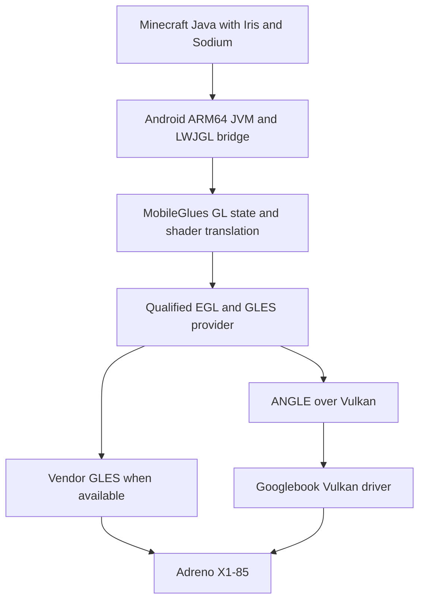

# MobileGlues X1E-80-100 Googlebook Implementation Plan

> **Superseded 19 October 2026.** This historical plan is retained for traceability and for the
> `Stage 0`-`Stage 8` identifiers used in earlier execution records. Current requirements are
> `docs/01_MobileGlues_Googlebook_Architecture.md`,
> `docs/02_MobileGlues_Googlebook_Implementation_Plan.md` and
> `docs/03_MobileGlues_Googlebook_Validation_and_Sources.md`. Do not use this file for new work
> or new support claims.

Research cutoff: 19 October 2026 UTC. Version 1.0.

## 1. Objective and recommended approach

Build a specialized MobileGlues distribution for native Android applications on Snapdragon X1E-80-100 Googlebooks. The user should be able to select a supported Minecraft Java instance, install an original shaderpack archive, and obtain the effects that the selected pack and preset actually provide, without manually editing GLSL, guessing a GL version, or enabling an ignore-errors workaround. Add future X2E Googlebooks through separate device and driver qualification.

The recommended foundation is the existing MobileGlues GLES implementation, paired with a pinned Android ARM64 launcher/JVM/LWJGL stack and Iris/Sodium. First establish correct desktop-GL semantics for the shader workloads. Then optimize the verified X1E path. Compare the available vendor GLES and ANGLE paths early; retain a bounded Vulkan-based desktop-GL investigation if GLES imposes a real limit on advanced effects.

This is a graphics compatibility project with a performance workstream. Compiler flags and a higher advertised OpenGL version cannot supply missing resource bindings, image formats, filtering behavior, or synchronization. Success requires measuring the actual Googlebook graphics driver. No on-device compatibility or FPS result is claimed in this plan.

### Release contract

| Requirement | Acceptance meaning |
| --- | --- |
| Original shaderpacks | The tested archive remains byte-identical to the author's release. Loader and translator transformations are permitted, recorded, and tested for equivalent behavior. |
| Feature fidelity | Reflections, shadows, PBR, temporal effects, and supported advanced effects remain active when the selected preset requests them. A visually incomplete frame is a failure even if compilation succeeds. |
| Simple installation | A qualified launcher instance and renderer profile establish the correct libraries, driver selection, configuration paths, and dependencies before loading Minecraft. |
| Honest compatibility | Results identify the game, loader, pack version, settings, backend, OS build, and driver. Unsupported features have a precise reason; they are never silently counted as working. |
| Target specialization | Production binaries, defaults, testing, and tuning focus on Googlebook ARM64 and qualified X1E/X2E devices. Desktop GL machines serve as reference renderers, not additional supported products. |
| Sustained performance | Improvements preserve the tested feature set and are measured at fixed internal resolution, with warm and cold caches and sustained AC/battery runs. |

Use three progressively stronger compatibility milestones: **standard shader fidelity**, **advanced colored lighting**, and **world-space reflections**. All three remain within the intended project; separating their acceptance gates prevents a working basic preset from concealing unfinished advanced features.

## 2. Verified platform and hardware basis

Google documents Googlebook as Android technology combined with ChromeOS desktop foundations. The Google Store lists an XPS Googlebook with the exact X1E-80-100, 16 GB RAM, and a 2560 × 1600 display with 30–120 Hz variable refresh. These establish a concrete native Android laptop target. The selected OEM model still determines memory, display, cooling, and sustained power behavior. [P1] [P2]

Qualcomm's [current product table](https://www.qualcomm.com/laptops/products/snapdragon-x-elite) identifies the X1E-80-100 GPU as Adreno X1-85 at up to 1.25 GHz. Its published platform specifications include 12 Oryon CPU cores, 3.8 TFLOPS, and up to 135 GB/s memory bandwidth. These are hardware/platform figures; Windows API listings and peak compute throughput do not establish Googlebook driver features or Minecraft performance. [P4]

Google's Linux Terminal Preview roadmap lists GPU/NPU acceleration and integrated Linux GUI applications as future work. Therefore, keep the rendering process on Android for the release baseline. The Linux VM can assist development and orchestration, but must not be required to render the game. [P3]

### Runtime architecture

Android 17 offers `com.android.graphics.driver.prefer_angle` as an application manifest preference. It does not guarantee ANGLE; the system may choose the vendor GLES driver. MobileGlues can also use launcher-provided ANGLE. These are distinct provider configurations and must not accidentally be mixed. Capture the actual provider in every result. [P5] [M12]

Choose one coherent EGL/GLES provider pair. Library-loading order, surface creation, and driver configuration belong to the launcher/renderer integration. A process restart is the safe boundary for changing a provider whose configuration is latched during native initialization.

### Backend decision

| Candidate | Role | Decision rule |
| --- | --- | --- |
| MobileGlues with vendor GLES | Initial candidate if the device exposes it | Prefer when it passes required semantics and offers better sustained performance. |
| MobileGlues with system or packaged ANGLE | Equal first-stage candidate | Qualify its actual GLES version, extensions, image formats, and presentation behavior. An additional translation layer can improve correctness; overhead must be measured. |
| Mesa Zink over the stock Vulkan driver | Bounded feasibility comparison for desktop-GL gaps | Compare against Zink's published Vulkan requirements and Android integration constraints. A Vulkan version string alone is insufficient. |
| Zink with an application-loaded Turnip driver | Experimental route | Require demonstrated compatibility with the exact GPU, kernel interface, Android allocator, and surface path on an ordinary production device. |
| MobileGL, the sibling project | Architectural reference and possible future alternative | It is a separate implementation, currently described as incomplete with a short-term GL 4.2 target. Do not make it an assumed drop-in replacement. |

Zink implements desktop GL over Vulkan and publishes feature requirements. Mesa's Android documentation also makes kernel and driver integration explicit. Neither source proves that an arbitrary downloadable Turnip build works on a shipping Googlebook. A production installation must not depend on replacing system drivers or obtaining root. [P6] [P7] [M14]

## 3. Pin the real baseline

The source inspection used the following identities. They are audit baselines, not a claim that the released APK contains every inspected change.

| Component | Inspected identity | Relevant distinction |
| --- | --- | --- |
| MobileGlues core | `97558a69157b033b890958b1e49258c5b51a80c6`, 22 September 2026 | Main branch snapshot; version header still says 2.0.0. |
| MobileGlues plugin | `f5105e4ddd1752cccdcc6421c402960d40ec3d9d`, 9 August 2026 | Its core submodule points to `f56af31d3e490d95808b3adc4ace20234249a37a`. |
| Complementary Reimagined source | `c09950df0650b27dac260c1b0f69afc11387aa6f`, r5.9.2 | Both original Reimagined and Unbound r5.9.2 archives were inspected as workloads. |
| Iris source | `bff1e69cb6c5519d8745784aa9c8b92984de67e7` | Used to inspect capability selection and shader preprocessing. Match a release to the chosen Minecraft version before shipping. |

Record core, plugin, launcher, JVM, LWJGL/native bridge, Iris, Sodium, optional ANGLE, compiler submodules, toolchain, and artifact hashes in a lock manifest. Do not identify a renderer build solely by its displayed version. The core and plugin can display the same version while containing different code. [M1] [M12] [S1] [I1]

The historical MobileGlues compatibility list used a Snapdragon 8 Gen 3/Adreno 750 phone with Minecraft 1.21.1, Iris 1.8.1, and Sodium 0.6.5, and is dated March 2025. It includes positive Complementary reflection/PBR results. This is useful prior evidence, but does not certify the X1E driver or today's advanced shaderpack paths. [M13]

### Game version policy

Select the first release tuple from official launcher, Minecraft, Iris, and Sodium release manifests. Pin a mutually supported game version and the corresponding Android ARM64 Java runtime. Do not combine independently selected latest versions. Two known release lanes are Minecraft 1.20.1 with Iris `1.7.6+1.20.1`, and Minecraft 26.1.2 with Fabric Iris `1.11.3+26.1-fabric`. Resolve Sodium, Fabric Loader, and Java requirements from the artifacts' actual dependency metadata; the first Iris release specifically notes Sodium 0.5.12 compatibility. These are reproducible candidates, not claims of latest versions or verified Android launcher support. [I4] [I5]

Qualify the modern lane for current rendering behavior and retain 1.20.1 as a separately pinned regression lane where launcher compatibility warrants it. Newer Minecraft renderers, including the 26.x depth/sampler case in upstream issue 57, need separate regression coverage. An older loader's documented feature or coordinate limitation must not be attributed automatically to MobileGlues. [M10]

## 4. Source audit and prioritized repairs

MobileGlues already contains glslang/SPIR-V/SPIRV-Cross translation, compute dispatch and image/barrier forwarding, MRT attachment remapping, indexed blend operations, multiple draw submission paths, a translated-shader cache, and optional profiling. Extend these implementations instead of planning each as a new subsystem. [M1] [M3] [M4] [M7] [M8]

The table distinguishes inspected behavior from a hypothesis about its effect on a particular pack. Every proposed repair must acquire a minimal reproducer before it is credited with fixing that pack.

| Priority | Inspected source behavior | Proposed action and proof |
| --- | --- | --- |
| P0 | `getter.cpp` always returns `GL_NO_ERROR`; shader/program settings can also mask unsuccessful status. | Preserve frontend errors and internal diagnostics; make failed compile/link operations visible. Audit translation-generated backend errors instead of blindly forwarding or swallowing them. [M2] [M3] [M5] |
| P0 | Fragment texture-unit limits are doubled; several substantial extensions are listed unconditionally. | Derive limits and advertised functionality from the backend plus complete implemented semantics. Test boundary values and loader decisions. [M2] |
| P0 | `glShaderSource` concatenates strings but passes the original count with a one-element array to the backend. | Add a count-greater-than-one regression with explicit lengths and fix submission/lifetime handling. This source-level hazard is independently testable. [M3] |
| P0 for standard fidelity | Depth format conversions, sampler forwarding, and copy paths need qualification against desktop behavior. | Test raw depth, comparison sampling, mip filters, copies, and shared samplers on the real driver. Avoid universal nearest-filter or depth-format substitutions. [M6] [M10] |
| P0 for standard fidelity | MRT routing already shuffles logical attachments onto physical GLES slots. | Verify sparse/permuted outputs, indexed blending, clear/readback, layers, and temporal history. Preserve mapping when optimizing reattachments. [M7] |
| P1 for advanced effects | `glShaderStorageBlockBinding` remains a stub; the translator removes matching binding qualifiers from noncompute shaders. | Implement resource reflection and binding translation, including nonzero bindings and application-visible queries. Do not assume default binding zero is sufficient. [M4] [M9] |
| P1 for advanced effects | Compiler resource tables include hardcoded values such as zero vertex image uniforms. | Build compiler limits from the effective contract and test captured vertex-image shaders. Rejection of a specific ACT shader remains a hypothesis until reproduced. [M4] |
| P1 | Shader/program metadata includes global last-shader state; cache identity omits important inputs. | Establish object/context ownership and correct keys before parallel compilation or binary caching. [M3] [M4] [M5] |
| P1/P2 by call coverage | Texture barriers, buffer clears, texture views, and other functions remain stubbed. | Rank required operations from the selected loader/pack trace. Implement exact required semantics or report unsupported behavior. [M9] |
| P2 | Mapped-buffer workarounds change persistent/coherent/explicit-flush flags; depth copies issue flushes. | Separate contract repairs from measured driver workarounds. Use fences and regression cases to validate any removal or fast path. [M6] [M8] |

### Use upstream depth work carefully

Issue 57 and open PR 61 describe comparison-disabled depth textures becoming filter-incomplete on strict GLES implementations. The proposed patch tracks texture/sampler pairings and substitutes legal filtering. Its author reports host tests and explicitly leaves device/Minecraft validation outstanding. Review it as useful prior work. A nearest-filter substitution can fix a particular completeness problem while still failing to reproduce genuine desktop linear-depth filtering. [M10] [M11]

The fidelity implementation should preserve raw-depth sampling separately from hardware shadow comparison. If a requested operation is unavailable, evaluate a validated shader lowering or a depth-color mirror that preserves filtering and read/write ordering. Prove the relevant behavior across 2D, arrays, mip levels, and sampler overrides; do not relabel a format or ignore an incomplete texture.

### Keep broad translator debt in proportion

The translator contains approximate `textureQueryLod` handling, derivative-control branch rewriting, and a heuristic that injects a GI temporal filter. These require review for broader shader compatibility. The inspected Complementary r5.9.2 source does not use those constructs, so they are not established causes of its SSR problems. Prioritize depth, explicit LOD/mips, HDR attachments, MRT routing, and temporal persistence for that pack. [M4] [S2]

## 5. Shaderpack feature requirements

### Standard reflections and advanced reflections are different workloads

Complementary r5.9.2 implements standard reflections through fragment-shader depth ray marching, projected coordinates, explicit-LOD color sampling, and history buffers. This path does not inherently require compute shaders or hardware ray-tracing units. Its advanced colored lighting uses voxel images and compute; world-space reflections add voxel/object data and SSBO access. [S2] [S4] [S5]

| Milestone | Effects to demonstrate | Underlying requirements |
| --- | --- | --- |
| Standard fidelity | Water and surface SSR, rough/specular reflections, shadows, supported PBR, ambient occlusion, fog/clouds, bloom, TAA | Correct GLSL interfaces; raw and comparison depth samplers; explicit LOD and mip chains; float/normalized render targets; logical MRT mapping; independent blend state; stable history textures. |
| Advanced colored lighting | Emissive blocks illuminate nearby geometry and supported fog; changes propagate correctly while moving | Loader custom-image support; vertex-stage image stores; 3D integer/float images; typed image translation; 512-invocation compute groups; correct graphics-to-compute-to-sampling visibility. |
| World-space reflections | Reflections of suitable geometry beyond the current screen view, with the pack's intended voxel limitations | Advanced lighting prerequisites plus SSBO storage/layout at binding 0, vertex-stage stores, image formats, and adequate resource sizes. Optional player reflections additionally exercise binding 3 and bounding-box atomics. |

SSR cannot display information absent from the screen buffers except through the pack's own fallback or history mechanism. Do not classify its normal screen-edge limitations as a MobileGlues bug. Likewise, world-space voxel reflections are not evidence of hardware ray-tracing support.

The inspected [pipeline format declarations](https://github.com/ComplementaryDevelopment/ComplementaryReimagined/blob/c09950df0650b27dac260c1b0f69afc11387aa6f/shaders/lib/pipelineSettings.glsl) request formats including `R11F_G11F_B10F`, `RGB8_SNORM`/`RGBA8_SNORM`, `RGB16F`, and `RGBA16F`. Test the actual usage of each format, including blending and history sampling where applicable. Preserving normal/material channels matters as much as obtaining a valid color framebuffer.

### Important r5.9.2 resource gates

Complementary's High profile leaves advanced colored lighting and world-space reflections disabled; Ultra requests the advanced 256 configuration. Record effective macros, allocated images/buffers, enabled programs, and visual results. A successful High test is not an Ultra test. The original allocation declarations include the following. [S3]

| Setting | Requested resource | Qualification implication |
| --- | --- | --- |
| Colored lighting | Compute local size 8 × 8 × 8 | The backend must support 512 invocations per group and the requested per-axis sizes. [S4] |
| Colored lighting 256 | One 256 × 128 × 256 R16UI volume and two RGBA16F volumes | Nominal texel storage is 144 MiB before other resources and implementation overhead. |
| WSR 128 | Buffer object 0: 50,855,936 bytes | Test one buffer of that size, not just total available memory. |
| WSR 192 | Buffer object 0: 114,229,248 bytes | A useful lower-resource supported option if otherwise faithful. |
| WSR 256 | Buffer object 0: 202,899,456 bytes, or 193.5 MiB | Must fit the effective per-block/range limit, with successful allocation and access. |
| WSR 512 or greater | Buffer object 0: 810,549,248 bytes, or 773 MiB | Treat high-distance configurations as separate memory/performance qualifications. |
| WSR images | R16UI and R8UI image resources; optional player SSBO uses binding 3 | Validate image storage formats, integer semantics, rebinding, and optional resources independently. [S5] |

The 144 MiB figure is calculated from the specified dimensions and nominal texel widths: `256 × 128 × 256 × (2 + 8 + 8) / 2^20`. ACT plus the main WSR allocations is approximately 345.56 MiB at 256 and 1,957.25 MiB at 512; the latter uses 1,152 MiB for ACT volumes alone. These are nominal declared-resource calculations, not measured allocations, and exclude framebuffers, game resources, JVM memory, format widening, and driver/OS overhead.

### Image format translation is a first-class problem

The pack uses desktop formatless write-only image declarations. ESSL 3.20 requires image format qualifiers, and its core image-format qualifier set does not include every desktop image format used here, notably R8UI/R16UI. Texture allocation support is therefore insufficient. [S4] [K1]

Resolve image type and format from the real resource contract. In the inspected Iris implementation, image units and formats are configured after program linking, so current GL bindings cannot generally supply the format at `glCompileShader`. Use a small pinned-Iris metadata bridge as the initial engineering approach: pass image declarations and their format/binding contracts before backend compilation, while leaving the original shader ZIP unchanged. This bridge is a proposed implementation, not an existing public interface. [I6]

If lowering a logical R8UI/R16UI image to an available backing format, preserve integer conversion, sampling, clear, copy, aliasing, and query behavior, and account for additional memory. A future generic variant system must preserve logical program IDs, uniform locations and values, block indices/bindings, queries, relinking, and image-format rebinding. A global textual insertion of a guessed format is not a valid solution.

If the provider cannot support the required stage operations, formats, or resource sizes with correct semantics, advance the bounded alternate-backend investigation. A smaller author-supported preset may be offered with its exact limitation stated; it does not certify the larger original preset.

### Loader decisions happen before MobileGlues receives GLSL

Iris constructs capability-dependent `IRIS_FEATURE_*` defines and preprocesses shader properties and sources before the final shader reaches GL. In the inspected source, SSBO support uses GL 4.4 or the combination of the SSBO and buffer-storage extensions. MobileGlues-injected macros arrive too late to revive programs or image allocations already removed by the loader. [I2] [I3]

Establish truthful capabilities before LWJGL constructs its capability table. Capture the loader environment and enabled pass list. If a verified ES-backed implementation needs a narrower capability interface, add a small, versioned Iris integration with an explicit semantic contract. Do not impersonate NVIDIA/AMD, force feature flags unconditionally, or raise the GL version as a substitute for implementation.

## 6. Internal architecture changes

### 6.1 Capability and driver profiles

Introduce proposed modules `platform/capability_probe`, `platform/device_profile`, and `compat/feature_contract`. Their names are new design suggestions, not existing upstream files.

A profile combines the actual OEM/device, SoC/GPU identity, backend/provider, OS build, driver identity, renderer build, and validated semantics. Keep three separate records: what the host advertises, what MobileGlues implements, and what the qualification suite demonstrates. Unknown or updated combinations receive conservative functional defaults and a short requalification, not inherited performance claims.

Make context creation, GL version/major/minor queries, GLSL version, any synthetic version entries, extension exposure, and debug/robust/no-error flags consistent. A successful shaderpack run does not demonstrate all requirements of a higher GL version or a robust context. Validate each promise; use the narrow loader bridge where workload support exists without a complete desktop-GL feature level.

The native probe must run below MobileGlues' synthesized GL queries, preferably in a companion process inside the same APK/package with identical driver preference, loading, and context configuration. Always verify the actual game process's selected provider. A separately packaged probe can select a different ANGLE/GLES provider and cannot alone establish the game's contract. Record:

- Android API/release/build, ARM64 ABI, actual page size, RAM, current window pixels, display mode, and device/SoC identification.
- EGL vendor/version/extensions, chosen config, surface colorspace, context flags/version, swap behavior, and provider libraries.
- GLES vendor/renderer/GLSL version, extensions, callable functions, precision support, program-binary formats, and relevant limits.
- Per-stage and combined texture, image, SSBO, uniform and output limits; combined shader-output constraints; draw-buffer versus color-attachment limits; 3D texture dimensions; compute local size/invocations/shared memory; SSBO maximum block size and alignment.
- Per-format allocation, sampling, filtering, color/depth rendering, blending, image load/store, clear/copy and readback behavior for the actual pack formats.
- Vulkan identity, features, properties, memory types and exact format usages when evaluating ANGLE or another Vulkan path. Include vertex stores/atomics and storage-image capabilities.
- Behavioral probes with pass/fail/unsupported results and diagnostic attachments. A function pointer is not a test.

### 6.2 Shader compiler and program contract

Retain the existing compiler stack. Normalize any legacy compatibility syntax before SPIR-V compilation; do not assume raw GLSL 120 is directly valid SPIR-V input. Account for transformations already performed by Iris so matrices, attributes, varyings, fragment outputs, and built-ins retain their meaning.

Use structured syntax/IR transformations for semantic changes; SPIRV-Cross provides reflection facilities that can support this work. [K2] Preserve source mappings through original archive source, loader-preprocessed GLSL, normalized GLSL/IR, emitted ESSL, and backend logs. Give each failure a stable stage/program/source identity.

Store reflection per shader and linked program: interface locations and types, uniform blocks, SSBO layouts/bindings, image formats/access/stages, samplers, transform-feedback settings if used, and relevant pre-link bindings. Preserve resource bindings through lowering and relinking. GLES has no direct equivalent for desktop SSBO block rebinding; implement a deliberate logical-to-physical map and qualified program variants where needed.

Use backend extensions only when the effective contract supports them. Preserve desktop numeric behavior in the fidelity profile. Keep any approximate workaround separately identified by exact source/profile/driver predicates and tested visual consequences.

### 6.3 Object state and ownership

Maintain share-group resource records and per-context bindings, error state, FBO mappings, and drawable state. Keep application GL error state separate from internal emulation and driver diagnostics: errors from internal probes must not leak later as unrelated application errors. Compile/link failures remain real failures. Object-name translation must round-trip through getters. Test interleaved shader/program creation, deleted-name reuse, two contexts using identical numeric names, and relinking after option changes.

Make translation jobs pure CPU work over immutable inputs before enabling worker threads. Shared caches and global compiler initialization need defined ownership. Backend compile/link calls remain on their owning context unless shared-context behavior is explicitly qualified. A mutex around a global last-shader record is not a replacement for per-object state.

### 6.4 Texture, framebuffer, and synchronization contract

Track logical format separately from backing format. Use a typed table of allowed conversions and relevant usage capabilities. Avoid silent D32-to-D24 or normalized-to-float substitutions in a claim of equivalent rendering. Reproduce the exact pack operation before selecting a lowering.

Keep raw depth and comparison sampler state distinct. Test state inherited through sampler objects, base/max mip levels, LOD clamps, border/clamp behavior, depth copies and read/draw FBO transitions. Maintain logical attachment identity when GLES requires a different physical output arrangement. Large logical `colortex` numbers do not imply the same number of simultaneous hardware draw buffers.

Preserve the API-requested history lifetime, clear behavior, and resize/recreation semantics. Iris and the pack own temporal reset policy; use explicit bridge signals for coordinated resets when necessary. Do not infer a reset from ordinary matrix or uniform changes: TAA deliberately jitters projection every frame. Do not discard a buffer merely because it is no longer the current render target.

Model graphics/image/SSBO/compute dependencies precisely. Use the appropriate memory barriers for writes becoming visible to later consumers. Preserve required API ordering and buffer fences. Texture feedback barriers have different semantics from memory barriers; a generic replacement cannot establish correctness.

### 6.5 Cache identity and recovery

Use separate caches for translated source and optional driver program binaries. The translated-source key should include the full effective source, shader stage, translation/compiler revisions, relevant feature/format/binding profile, and transformation options. The program key also includes all linked stages and pre-link interface state.

Binary caches additionally require driver/provider identity and binary format. Invalidate them on incompatible OS/driver changes. Treat rejection or corruption as a normal cache miss and rebuild safely. Keep cache writes atomic and bounded; preserve the existing batched persistence where correct. Never reuse artifacts from a different capability profile simply because the displayed MobileGlues version matches.

## 7. X1E performance strategy

### 7.1 Measure the layer that limits the frame

Instrument CPU frame preparation, time inside the wrapper, shader translation/linking, GPU pass time where supported, submission waits, presentation, and Minecraft simulation/chunk activity. Capture median, p95, and p99 frame times together with dropped/repeated frames. Keep compatibility/debug runs separate from release timing runs.

Use Perfetto or Android Performance Analyzer system traces, lightweight app trace markers, and validated GLES timer queries. Check query availability and disjoint conditions; read results asynchronously. Verify Qualcomm counter/compiler tools against this exact GPU and driver before making them a required dependency. APA frame capture currently requires ANGLE for OpenGL and warns about non-Pixel compatibility. Switching a vendor-GLES run to ANGLE for capture changes the backend being studied. [P8] [P9]

Every optimization result must include a feature signature: pack hash, settings, effective feature macros, enabled programs, target sizes/formats, and important resource allocations. A faster run with missing WSR, disabled fog, or reduced internal resolution is a different workload.

### 7.2 Reduce framebuffer traffic while preserving lifetime

Adreno performance work should investigate tile-memory loads/stores, attachment changes, full-screen passes, texture reads, and depth-copy costs. Qualcomm provides explicit GMEM examples, while Mesa documents both tiled and direct-to-system-memory paths. Do not assume every pass benefits from forced tiling. [P10] [P11]

Prioritize these changes:

1. Cache physical attachment layouts by logical FBO generation, image/layer/mip identity, and draw-buffer mapping. Apply only necessary binding changes.
2. Avoid repeating legal format conversions or reallocating unchanged storage during normal frames.
3. Preserve true texture-buffer paths where the chosen provider supports them; avoid unnecessary emulation and upload copies.
4. Remove proven redundant internal flushes only under a driver profile with the original depth/copy regressions passing.
5. Honor explicit discard/invalidate requests. Add a lifetime optimization only when a loader resource contract proves that no later pass, frame, copy, or readback needs the contents.

A nominal example shows why this matters: a 2560 × 1600 RGBA16F buffer contains 32.768 MB. One full-screen read plus write represents 65.536 MB per frame, or about 3.93 GB/s at 60 FPS before cache, compression, and tiling effects. This is arithmetic for an illustrative pass, not measured physical traffic. Multipass effects can therefore make target formats and internal resolution more important than small CPU compiler changes.

Do not merge or reorder arbitrary shaderpack passes. A loader-assisted optimization needs a dependency proof covering samplers, images, SSBOs, history, blending, and barriers.

### 7.3 Improve CPU submission and buffer streaming

Use the existing multidraw alternatives as candidates, then measure real Sodium geometry and shadow passes. Track submitted draw counts, fallback counts, CPU-copied command/index bytes, upload volume, and synchronization stalls. Native multidraw, indirect paths, and compute-generated indices can have different winners on this GPU.

Build fast paths for verified common operations while retaining correct state restoration at API boundaries. Eliminate redundant wrapper allocation, repeated uniform lookup, and unnecessary driver state queries. Never remove application-observable operations merely because one benchmark does not notice.

Use reusable upload/staging rings with fences and explicit ownership. Qualify persistent/coherent mapping only where supported and correct. The current `buffer_coherent_as_flush` workaround changes behavior; replace it with a documented contract or a tightly tested driver exception rather than treating it as a universal optimization. Preserve offsets, dirty ranges, alignment, and virtual object names. [M8]

### 7.4 Reduce shader stutter

After cache identity and object ownership are corrected, perform CPU translation concurrently during pack loading. Bound worker count so chunk generation, the JVM, and the render thread retain capacity. Use backend parallel-compile facilities only when supported and correctly handled; do not poll in a way that repeatedly blocks the frame.

Prewarm only deterministic shader/program combinations whose complete inputs are known. Cache misses should expose useful loading progress. Measure initial pack load, option reload, first dimension transition, and warm relaunch separately. Optional program-binary caching should have a safe source-compile fallback.

### 7.5 Preserve precision before offering quality tradeoffs

Keep depth reconstruction, world/camera-relative coordinates, projection matrices, motion/history coordinates, integer material IDs, and data packing at their required precision. Do not apply global `mediump`, fast-math, loop truncation, reduced ray steps, or smaller render-target formats in the fidelity profile.

A later performance preset may use author-exposed reflection resolution, shadow resolution/distance, cloud quality, or render scale. Record it as a quality/performance choice. Preserve selected effects where practical. Existing FSR1 or a pack's own upscaling path can be evaluated separately; upscaling is not a semantic compatibility fix and must not be hidden inside native-resolution benchmark comparisons.

### 7.6 Build and CPU tuning

Ship ARM64 target artifacts. Audit the actual generated compiler commands: the core already attempts ThinLTO, so simply adding LTO is not a new optimization. Pin the NDK and compiler submodules. Compare conventional optimization levels and workload-based PGO only after wrapper CPU time is material. Verify toolchain support for any Oryon-specific tuning and keep a compatible code-generation baseline for each qualified SKU. [M15]

Do not tune for phone big/little assumptions. Let Android schedule the actual laptop topology; use supported performance hints with measured thread roles rather than permanently pinning cores or forcing clocks.

### 7.7 Presentation and sustained operation

Choose one presentation owner in the launcher/renderer bridge. Integrate Android frame pacing there, coordinating Minecraft's limiter, swap interval, and any OS pacing instead of stacking independent throttles. The Swappy GLES API wraps presentation and must receive updated native-window information. [P12]

Use Swappy only when initialization and the required EGL support succeed on the selected provider, and retain a fallback pacing path. Preserve the intended renderer/provider presentation dispatch, including MobileGlues presentation hooks, when wrapping swaps.

Separate display pixels, framebuffer pixels, pack render scale, and Minecraft UI scale. Suggested measurement points for a 16:10 device are 1600 × 1000, 1920 × 1200, and 2560 × 1600. For external displays, record the actual window and refresh mode. Test 60 and 120 Hz presentation; additional caps depend on verified refresh/VRR behavior.

Use Android thermal/performance APIs where meaningful on the target. Validate returned status/headroom and avoid aggressive polling. Benchmark cold start and a sustained session of at least 20 minutes, on AC and battery, while recording thermal state and frequency data when available. A laptop power adapter rating is not a GPU power budget. [P13]

## 8. Staged implementation with acceptance gates

Stages may overlap only where their inputs are independent. Standard-fidelity work and the early advanced-capability experiment can run in parallel. No later performance claim may depend on silently disabling an earlier feature.

| Stage | Main owner | Deliverable | Exit gate |
| --- | --- | --- | --- |
| 0 | Platform/integration | Locked stack, reproducible ARM64 build, real-device capability report | Same provider proven in probe and game; baseline loads with diagnostics. |
| 1 | GL correctness | Traceable calls, real status, capability contract, regression harness | Failure masking removed from qualification; first source hazards reproduced and fixed. |
| 2 | Compiler/state | Per-object shader state, reflection, format metadata bridge, safe cache identity | Captured standard shaders translate correctly; bindings and relinking round-trip. |
| 3 | Rendering | Complementary standard fidelity | Both original r5.9.2 styles at High pass required visual and temporal tests. |
| 4 | Compiler/rendering | ACT image and compute path | Original pack at ACT 128 then 192 produces correct moving colored lighting. |
| 5 | Rendering/driver | WSR storage and traversal path | WSR 128 and Ultra 256 independently qualified; optional player path separately reported. |
| 6 | Performance/platform | Measured X1E optimization profile and desktop integration | Fixed-workload improvement with no fidelity regression; sustained/lifecycle gates pass. |
| 7 | QA/release | Broader corpus, integrated release, known-limit matrix | Stock installation reproduces the qualified results and recovers safely after updates. |
| 8 | Platform/QA | New X2E device qualification | Fresh probe, regression corpus, and performance profile; no inherited qualification. |

### Stage 0: lock, build, and identify the real driver

0.1 Create an isolated development checkout with an upstream remote and a dedicated feature branch. Record the audit SHA, then inspect later upstream changes before choosing the implementation base. Preserve a clean baseline build and binary hash.

0.2 Build the selected core/plugin combination through a pinned Android toolchain. Resolve all launcher/JRE/LWJGL dependencies and native entry points. Establish app-owned configuration/cache/log directories before native initialization. Confirm the selected library actually loads in the game process.

0.3 Build the capability probe and run it on the X1E Googlebook. Inventory vendor GLES, system ANGLE, and packaged ANGLE only where each is available. Capture the provider pair, limits, and format tests for each configuration.

0.4 Create a frozen world, camera path, resource-pack set, and initial desktop reference. Run vanilla/Sodium without shaders, then both Complementary High styles. Record visible omissions and error/pass evidence without attempting broad optimization.

0.5 In parallel, probe the advanced hard limits: vertex image stores, 512 local invocations, R8UI/R16UI representation, and the 193.5 MiB WSR block/range. If the preferred provider has an unworkable constraint, conduct a time-bounded ANGLE/Zink feasibility experiment before investing deeply in that path.

Exit artifacts: `stack-lock.json`, device/provider reports, build instructions, baseline timings, pack hashes, reference scenes, and a ranked issue list. These filenames are proposed implementation outputs. Without target-device access, complete build/host work and mark this device gate pending; do not manufacture measurements.

### Stage 1: make failures observable

1.1 Add structured diagnostics that survive release logging settings. Separate application GL errors, translated-operation diagnostics, and shader compiler/linker failures. Keep validation detail configurable without losing essential failure summaries.

1.2 Inventory GL calls and GLSL constructs exercised by each test lane. Count any route into a stub. Associate calls and shader programs with loader pass names through an explicit debug bridge when available.

1.3 Reproduce and fix the multi-string shader-source hazard. Add focused lifecycle tests for interleaved shaders, explicit lengths, failed compilation, relinking, deletion, and name reuse.

1.4 Replace exaggerated numeric limits and unconditional feature admission with the effective capability contract. Test the resulting Iris feature macros and loader behavior. Do not advertise a full extension while leaving required behavior as a stub.

Exit gate: intentionally invalid shaders fail, missing operations are visible, capability boundary tests behave consistently, and the known successful baseline still renders correctly.

### Stage 2: preserve shader and resource semantics

2.1 Replace global last-shader assumptions with a per-shader/per-program graph and source/reflection records. Preserve cross-stage interfaces and pre-link output bindings.

2.2 Derive translation limits from supported effective capabilities. Validate captured vertex, fragment, and later compute shaders against those limits.

2.3 Implement binding preservation and the initial Iris image-metadata bridge. The bridge must describe actual resources before ESSL compilation, not merely enable feature macros. Handle post-link uniform/image setup and relinking consistently.

2.4 Correct cache keys and profile invalidation. Add deterministic source-level tests for changed stage, format signature, compiler build, backend capability, and option inputs. Do not introduce multithreaded GL compilation during this repair.

Exit gate: semantic test programs and captured standard pack shaders produce correct interfaces/resources; original archives remain unchanged; source maps explain failures; no stale cache survives a relevant change.

### Stage 3: complete standard Complementary fidelity

3.1 Implement and test the required format/texture/sampler operations, including signed-normalized data and supported HDR targets. Verify both allocation and every usage the pack needs.

3.2 Repair depth sampling/copy/filtering on the selected provider. Review upstream PR 61 with its limitations. Exercise comparison samplers and raw depth in the same scene, including one sampler reused with color and depth resources.

3.3 Verify per-pass MRT layout, high logical output indices, independent blending, clear masks, mip generation, and read/draw FBO changes. Add a minimal regression for each observed mismatch.

3.4 Compare SSR on water and reflective materials, roughness/PBR channels, shadow edges, clouds/fog, bloom, and moving TAA/history. Include rapid camera turns, occlusion changes, rain, underwater transitions, and all three dimensions.

3.5 Test shader-option reload and window resize. Any temporal reset follows the loader/pack contract.

Exit gate: exact original Reimagined and Unbound r5.9.2 archives at High pass the named effects at identical reference settings, with stable motion sequences and no masked compile/link failure. This is the first broadly useful compatibility release candidate.

### Stage 4: implement ACT without hiding requirements

4.1 Establish vertex image-store support end to end: compiler limits, ESSL legality, image binding, correct format representation, and backend stage limits.

4.2 Implement the pack's voxel and alternating-light image contracts. Prove integer IDs, texture/image views, clear policy, and format conversions through readback tests.

4.3 Run the original 8 × 8 × 8 compute pass. Preserve invocation semantics and dependencies. Do not reduce local size automatically; such a transformation must account for workgroup IDs, local IDs, shared memory, and barriers.

4.4 Validate ACT at 128, then the Very High 192 configuration, with WSR explicitly disabled for isolation. Test emissive-block placement/removal, travel, world/dimension changes, and relevant coordinate limits. Shared-memory code that is disabled by the pack is not part of the default acceptance path.

Exit gate: the enabled passes write meaningful voxel/light data and produce correct moving colored lighting. If an image/stage requirement cannot be implemented, record the blocker and evaluate the alternate backend; do not claim ACT by substituting static colored light.

### Stage 5: implement WSR and optional player reflection

5.1 Complete SSBO allocation, binding/range queries, `std430` layouts, runtime arrays, graphics-stage access, data packing, clears, and visibility. Test binding 0 with access near the end of the requested range.

5.2 Validate WSR at 128 as a debugging case, then 256 for the original Ultra profile. Run both capability-limit checks and real allocation/read/write tests. Keep lower-volume success separate from Ultra qualification.

5.3 Test reflections of controlled geometry outside the screen view, then moving/occluding geometry and resource reload. Compare the pack's expected voxel limitations with the reference.

5.4 Enable player reflections separately to exercise binding 3, vertex data, bounding-box atomics, and atlas updates. Record base WSR and player WSR as separate results.

5.5 Test 512 or larger settings only with a justified memory budget and explicit qualification. Do not make a high-distance preset the default merely because allocation succeeds.

Exit gate: Ultra 256 matches the defined reference cases; optional player behavior has its own status. When a stock driver imposes an unresolvable limit, publish the exact supported preset boundary and carry the full target into the alternate-backend decision.

### Stage 6: optimize and finish desktop behavior

6.1 Establish a corrected, unoptimized baseline. Rank actual bottlenecks before changing submission, FBO state, upload paths, or shader scheduling.

6.2 Implement one measurable change per experiment. Compare identical settings and replay paths, retaining image/temporal checks. Revert optimizations whose benefit disappears under repeated sustained runs.

6.3 Integrate one frame-pacing owner, desktop input/focus handling, surface resizing, display changes, context-loss recovery, and supported thermal hints in the launcher bridge.

6.4 Select the default backend and quality preset from qualification. A brief first-run check verifies identity and critical behavior; it should not require a lengthy benchmark on every launch. Backend changes require restart and safe fallback.

Exit gate: CPU/GPU/presentation evidence explains the improvement; sustained AC/battery runs pass; supported effects remain enabled; maximize/restore/fullscreen/sleep/resume and shader reload are stable.

### Stage 7: broaden, package, and release

7.1 Add the other shaderpack lanes in section 9. A shared semantic fix should benefit more than a single shader hash; demonstrate that where applicable.

7.2 Ship the integrated renderer profile, installation instructions, exact dependencies, ARM64 artifacts, checksums, symbols, source/build identity, and a user-readable compatibility matrix. Ensure a clean installation reproduces results without developer shell settings.

7.3 Validate upgrade, cache rejection, failed shader load, provider fallback, and rollback to the previous known-working renderer/profile. Keep worlds and user settings separate from generated caches.

7.4 Preserve project notices and review each distributed dependency's license. Distribute renderer/bridge code and official shader acquisition links/fixture hashes; do not assume shaderpack source availability grants permission to redistribute modified archives. [M1] [S9]

Exit gate: an ordinary supported Googlebook installation reproduces the qualified effect/preset matrix, and the release notes accurately identify remaining limitations.

## 9. Validation corpus and reproducible evidence

### 9.1 Frozen shader fixtures

The three ZIP checksums below were calculated from official release downloads inspected for this plan. Keep the archives untouched and retain author distribution metadata. Future releases join a new fixture row instead of replacing an old test silently.

| Fixture | Official release | SHA-256 |
| --- | --- | --- |
| Complementary Reimagined | r5.9.2, Modrinth `vxxxESqv` | `7ae5f1d6a4237a5c8893578397e58c9d08b79d7403bc27242aef56957489a278` |
| Complementary Unbound | r5.9.2, Modrinth `nahkiiZN` | `2b4e9c717758fd1ba1d6306f2e847096704196f0823c4d6941b3de6f423121d2` |
| BSL | v10.1.8, Modrinth `Y68yiql9` | `36b0a50ff7918bf10e9422c401d93779f9d0088a26acea975b435243f96930b5` |

Official acquisition URLs are listed under [S6]. The two Complementary styles need independent visual checks even though their released shader source differs only in the style selection in `common.glsl` after newline normalization.

### 9.2 Coverage beyond Complementary

| Workload | Purpose and initial settings |
| --- | --- |
| BSL v10.1.8 standard | Legacy GLSL/LOD translation, depth/reflections, PBR and postprocessing. Its multicolored block-light option is disabled by default. |
| BSL multicolored block light | Verify that the image-format and vertex-store solution generalizes. The inspected option uses R8UI voxels, alternating float light volumes, and 512-invocation compute without an SSBO declaration in its properties. [S6] |
| Photon source `5c79f54de3b8377ad2970a0181bf03f592354aca` | Texture-gather, temporal, PBR and compute coverage. Default skylight uses compute in this snapshot; do not label it raster-only. Keep optional Photonics/LOD integrations outside the first lane. [S7] |
| Rethinking Voxels source `1fd788f2c897169b7fc3375f0cb77526a2e65dc9` | Optional older stress corpus for geometry-stage storage/atomics and more demanding image/compute chains. This March 2024 source is deliberately pinned, not described as the latest release. [S8] |
| Sildur or another mainstream pack | Add after acquiring a specific official version and checksum. No uninspected release is predeclared compatible. |

Mod compatibility belongs to the complete game tuple. First reproduce a graphics problem without optional mods. Distant Horizons, Voxy, and other LOD modifications can change shader paths and resource requirements; any future support should receive explicit additional test lanes after the initial shaderpack release.

### 9.3 Small semantic tests

Implement the tests needed to establish concrete graphics contracts and prevent recurrence of observed bugs. This is not a request for a broad test framework with no rendering oracle.

| Test group | Required cases |
| --- | --- |
| Source/program lifecycle | Multiple source strings and lengths; interleaved shaders/programs; explicit outputs; link failure; relink; delete/reuse; cache miss/hit equivalence. |
| Capability/context contract | Limits at and beyond boundaries; unsupported operation handling; version/extension consistency; context flags; function availability; loader macro decisions. |
| Texture formats | Integer/signed-normalized/float values; logical versus backing formats; legal uploads/readbacks; mip completeness; 2D/3D/array usage. |
| Depth and samplers | Raw versus compare reads; shared sampler objects; min/mag/mip filters; LOD clamps; compare-mode overrides; render/copy/sample transitions. |
| Framebuffers | Sparse/permuted attachments; `GL_NONE`; high logical indices; mixed format classes; per-target blend; clear masks; separate read/draw FBOs; layer/mip attachment queries. |
| SSBO and images | `std430` offsets/runtime arrays; binding 0 and optional 3; range offsets/alignment; frontend-name queries; typed/formatless metadata; integer image conversion; large-range access. |
| Dependencies | Vertex image write → compute → fragment sampling; vertex SSBO write → fragment read; required atomics; explicit clears; correct memory barriers; any required legal texture feedback. |
| Lifetime and contexts | Resource deletion/reuse; reload; surface replacement; shared/nonshared contexts; cache invalidation and rejected binaries. |

Use exact expected values for integer IDs and appropriate exact-copy operations. Choose floating-point tolerances from the format and operation's allowed precision, not from whatever the new implementation happens to produce. A semantic mismatch remains a failure even when the final image looks plausible.

### 9.4 Visual and temporal scenes

Use a world with identifiable water, reflective surfaces, controlled PBR materials, translucent layers, emissive blocks, moving entities, and shadow edges. Provide fixed camera tracks and comparable weather/time conditions. Create a small owned synthetic resource pack when controlled normal/roughness/material values are needed.

Capture:

1. Still views after a fixed temporal warm-up: water/material reflection content, roughness response, shadow PCF, normal direction, emissive behavior, fog/clouds, and bloom.
2. Motion sequences: slow pan, rapid rotation, newly revealed surfaces, near/far geometry, underwater entry/exit, rain transitions, and dynamic light changes.
3. Advanced effect isolation: ACT without WSR; WSR with fixed off-screen geometry; optional player reflections; small versus large volume settings.
4. Intermediate buffers: selected depth, normals/materials, HDR scene color, reflection history, TAA history, and advanced voxel/light/SSBO data.

Use the same game/loader/pack versions, settings, resolution, camera path, resource pack and convergence interval on the desktop reference and Googlebook. Record unavoidable driver differences. Image metrics help locate discrepancies, but a high similarity score does not excuse missing reflections or ghosting. Review affected regions and motion, not merely one screenshot.

### 9.5 Performance protocol and targets

For each baseline/candidate pair, lock device mode, backend, OS/driver, world, game tuple, preset, render resolution and features. Separate initialization, shader compilation, active chunk generation, and steady rendering. Repeat runs in a balanced order so heating or background work does not consistently favor one build.

Report frame-time median/p95/p99, GPU and wrapper CPU time where observable, shader load/reload latency, peak memory, draw/upload counters, dropped/repeated frames, and thermal behavior. Include run-to-run variation and enough repetitions to distinguish a gain from noise. Keep raw run metadata with the result.

Proposed product targets, to be ratified after Stage 0 measurements:

| Area | Initial engineering target |
| --- | --- |
| Standard playability | Pursue a stable 60 FPS / 16.67 ms frame budget at 1920 × 1200 with a qualified standard preset. This is an aspiration, not a forecast for this GPU. |
| Advanced quality | Establish the highest ACT/WSR preset sustainable on the measured device, recording both frame-time distribution and memory. Do not promise Ultra 60 FPS before measurement. |
| Optimization acceptance | Same verified output/features, with a repeated frame-time or stutter improvement larger than measurement noise; no material p95/p99 regression. |
| Reload and warm launch | No stale shader result; a demonstrable reduction in repeated translation/link work where caching applies. |
| Sustained operation | At least 20 minutes of the defined workload without renderer failure or uncontrolled memory growth; AC and battery separately reported. |

The internal rendering resolution must appear next to every FPS result. A 2560 × 1600 frame has about 1.78 times the pixels of 1920 × 1200; 2880 × 1800 has 2.25 times. Do not describe a render-scale gain as faster translation at unchanged workload.

## 10. Googlebook installation and desktop lifecycle

Most desktop integration belongs in the launcher/native bridge, while MobileGlues owns the GL/EGL behavior it exposes. The release work must assign these responsibilities explicitly.

| Concern | Required behavior |
| --- | --- |
| Initialization | Load the selected renderer and provider in the intended order; configure paths and capabilities before LWJGL/Iris initializes. |
| App storage | Use app-owned configuration, cache and diagnostics directories. Import shader archives through the launcher's supported file flow. |
| Native packaging | Build ARM64 and audit all native libraries, including JVM/LWJGL/provider dependencies, for the actual Android page size and compatible ELF/APK alignment. |
| Window resizing | Recreate/update surfaces and framebuffer dimensions coherently; allow the loader to rebuild targets and reset temporal state appropriately. |
| Input/focus | Support relative mouse capture, keyboard and wheel input, menus, focus loss/reacquisition, and correct caption/system insets. |
| External displays | Track physical pixel size, scale, refresh changes and presentation surface; avoid stale render targets after moving a window. |
| Lifecycle | Test minimize/restore, fullscreen changes, sleep/wake, context loss and renderer restart. Release pointer capture appropriately. |
| Failures | Preserve a useful error report; return to a recoverable launcher state; restore the last working renderer/profile without overwriting worlds. |

Android documents native-library changes required for 16 KB pages; NDK r28+ and AGP 8.5.1+ simplify compatible alignment. Query the actual device page size and audit the complete native dependency chain. A newly rebuilt MobileGlues library alone cannot repair an incompatible JVM or bundled provider. [P14]

Use a distinct fork identity and clear version/build metadata. The renderer plugin is not itself a Minecraft distribution: the qualified launcher must supply the Android-native JVM, LWJGL/GLFW bridge, game instance management, and normal game installation/authentication flow. Current plugin metadata/configuration provides an integration starting point, not proof that all launchers initialize it equivalently. [M12]

The user-facing default should be a named profile such as “Automatic for this Googlebook,” selected from qualified combinations. Retain author-exposed shader options. A compact status page can show the active renderer, driver/profile, effective preset and any unsupported effect that changes the user's choice. Keep internal shader/GL diagnostics in an exportable troubleshooting view.

## 11. X2E onboarding

Reuse feature contracts, tests, launcher integration and compiler architecture. Requalify hardware limits, driver behavior, cache identities, and performance policy for each actual X2E Googlebook.

Mesa's pinned device table places Adreno X1-85 in A7XX and X2-85 in A8XX. That supports treating them as distinct GPU generations; it does not demonstrate that a particular Mesa binary is loadable on either shipping Android device. The exact X2E Googlebook model and OS/driver build remain an onboarding input. [P15]

Stage 8 tasks:

1. Identify the actual SoC/GPU variant and OEM configuration; do not map all `X2E` names to one profile.
2. Run the same below-wrapper capability and behavioral probes used on X1E.
3. Start with conservative functional settings and a new cache namespace. Do not inherit driver exceptions, preferred multidraw mode, worker counts, or quality defaults automatically.
4. Re-run standard, ACT, WSR, player-reflection and lifecycle tests on original fixtures.
5. Compare available providers and remeasure sustained CPU/GPU/presentation behavior.
6. Promote only the tested combination to the support matrix. Unknown X2 hardware can attempt the functional path but must not receive an unearned compatibility/performance claim.

A higher peak GPU or memory specification can change the best preset, but cannot establish support for image formats, workgroups, buffer ranges, or app-level driver loading.

## 12. Coding-agent execution contract

### Work organization

Use one integration owner and parallel agents with disjoint responsibilities: GL state/textures/framebuffers, compiler/Iris resource contracts, and Android/device/benchmark infrastructure. An independent reviewer checks source interpretations and test evidence. Agree on shared capability/resource interfaces before agents edit overlapping files.

Keep an upstream remote and a task branch. Commit small complete changes with the relevant stage and regression reference. Record base and dependency SHAs, commands, results, unresolved blockers, and next concrete action in an execution-state file. Avoid mixing a toolchain upgrade, semantic rewrite and performance experiment in one commit.

After every meaningful change:

1. State the observed problem and identify the source/call/shader evidence.
2. Reproduce it with a minimal semantic or visual test.
3. Implement the smallest correct change that preserves the documented contract.
4. Run the targeted test plus the relevant previously qualified regression cases.
5. Record original pack hash/settings, actual device/provider identity, and what was or was not tested.
6. Commit the change and update the feature matrix and execution state.

Keep planning bounded. If two implementation attempts fail for the same unexplained reason, collect a smaller reproducer and reassess the layer responsible. If the actual device is unavailable, continue independent build/compiler/host tasks and leave the hardware gate explicitly pending. Repeated document rewrites and guessed screenshots do not advance qualification.

### First concrete backlog

| Order | Task | Evidence required before marking complete |
| --- | --- | --- |
| 1 | Lock core/plugin/launcher/Java/Iris/Sodium/toolchain identities | Manifest and successful baseline ARM64 build. |
| 2 | Establish renderer loading and app-owned paths | Log from the actual Minecraft process. |
| 3 | Probe native provider and required formats/limits | Machine-readable output from the target Googlebook. |
| 4 | Add usable compile/link/error diagnostics | Deliberate invalid input produces the expected visible failure. |
| 5 | Fix multi-string shader-source handling | Focused failing-then-passing regression and lifecycle checks. |
| 6 | Capture both Complementary High styles and effective pass lists | Original hashes, desktop reference, target images and shader logs. |
| 7 | Resolve the first depth/mip/format/MRT mismatch | Minimal semantic reproducer and visual improvement. |
| 8 | Check ACT/WSR hard limits and image-format timing | Actual limit/access tests and a reviewed Iris metadata design. |
| 9 | Complete standard-fidelity gate | All required effects and temporal/lifecycle cases documented. |
| 10 | Advance ACT/WSR and measured optimization branches | Independent feature gates plus unchanged-workload comparisons. |

### Completion vocabulary

Use explicit statuses: **not tested**, **fails to load**, **loads with missing effects**, **correct for this preset**, **correct but below the performance target**, and **qualified for release**. Add the precise reason for any unsupported option. Passing a pack-specific suite is internal workload qualification, not Khronos conformance certification.

The project is complete for an X1E release only when the stated original-pack/preset/effect matrix, installation path, sustained performance profile, and recovery behavior are demonstrated on the actual supported Googlebook. Remaining advanced limitations stay visible and retain their own backlog.

## 13. Sources and implementation references

Platform claims use Google, Qualcomm, Khronos and Mesa documentation. Implementation observations come from the pinned public source checkouts. Issue/PR reports are leads with their own stated environments and validation limits. Proposed modules, milestones, targets and optimization choices are engineering recommendations.

### Platform and graphics stack

- **P1.** [Google developer overview of Googlebook](https://developer.android.com/develop/adaptive-apps/guides/googlebook/overview).
- **P2.** [Google Store XPS Googlebook specifications](https://store.google.com/us/product/xps_googlebook_specs?hl=en-US).
- **P3.** [Googlebook Linux Terminal Preview and roadmap](https://developer.android.com/blog/posts/googlebook-linux-terminal-preview-vm).
- **P4.** [Qualcomm Snapdragon X Elite product brief](https://www.qualcomm.com/content/dam/qcomm-martech/dm-assets/documents/Product-Brief-Snapdragon-X-Elite.pdf).
- **P5.** [Android Vulkan and ANGLE overview](https://developer.android.com/games/develop/vulkan/overview).
- **P6.** [Mesa Zink feature requirements](https://docs.mesa3d.org/drivers/zink.html).
- **P7.** [Mesa Android driver build and integration documentation](https://docs.mesa3d.org/android.html).
- **P8.** [Android Performance Analyzer frame compatibility](https://developer.android.com/android-performance-analyzer/frame-profiler/compatibility).
- **P9.** [Qualcomm GPU performance tools and sustained profiling guidance](https://www.qualcomm.com/developer/blog/2025/08/optimize-performance-and-graphics-for-adreno-gpu-low-power-gaming).
- **P10.** [Qualcomm Adreno graphics samples including GMEM examples](https://www.qualcomm.com/developer/snapdragon-game-toolkit/samples).
- **P11.** [Mesa Freedreno and Turnip architecture documentation](https://docs.mesa3d.org/drivers/freedreno.html).
- **P12.** [Android Swappy OpenGL frame-pacing integration](https://developer.android.com/games/sdk/frame-pacing/opengl/add-functions).
- **P13.** [Android Dynamic Performance Framework thermal APIs](https://developer.android.com/games/optimize/adpf/thermal).
- **P14.** [Android 16 KB page-size compatibility](https://developer.android.com/guide/practices/page-sizes).
- **P15.** [Mesa pinned Adreno device-generation table](https://chromium.googlesource.com/external/gitlab.freedesktop.org/mesa/mesa/+/f1ec46beaa6739fb15de953e6f4dc679b4e8c07f/src/freedreno/common/freedreno_devices.py).

### MobileGlues implementation

- **M1.** [MobileGlues project and inspected source tree](https://github.com/MobileGL-Dev/MobileGlues/tree/97558a69157b033b890958b1e49258c5b51a80c6).
- **M2.** [MobileGlues capability and error getters](https://github.com/MobileGL-Dev/MobileGlues/blob/97558a69157b033b890958b1e49258c5b51a80c6/MobileGlues-cpp/gl/getter.cpp).
- **M3.** [MobileGlues shader lifecycle](https://github.com/MobileGL-Dev/MobileGlues/blob/97558a69157b033b890958b1e49258c5b51a80c6/MobileGlues-cpp/gl/shader.cpp).
- **M4.** [MobileGlues GLSL translation and compiler resources](https://github.com/MobileGL-Dev/MobileGlues/blob/97558a69157b033b890958b1e49258c5b51a80c6/MobileGlues-cpp/gl/glsl/glsl_for_es.cpp).
- **M5.** [MobileGlues linked-program handling](https://github.com/MobileGL-Dev/MobileGlues/blob/97558a69157b033b890958b1e49258c5b51a80c6/MobileGlues-cpp/gl/program.cpp).
- **M6.** [MobileGlues texture formats, copies and sampling state](https://github.com/MobileGL-Dev/MobileGlues/blob/97558a69157b033b890958b1e49258c5b51a80c6/MobileGlues-cpp/gl/texture.cpp).
- **M7.** [MobileGlues framebuffer routing](https://github.com/MobileGL-Dev/MobileGlues/blob/97558a69157b033b890958b1e49258c5b51a80c6/MobileGlues-cpp/gl/framebuffer.cpp).
- **M8.** [MobileGlues buffer storage and mapping](https://github.com/MobileGL-Dev/MobileGlues/blob/97558a69157b033b890958b1e49258c5b51a80c6/MobileGlues-cpp/gl/buffer.cpp).
- **M9.** [MobileGlues unimplemented entry points](https://github.com/MobileGL-Dev/MobileGlues/blob/97558a69157b033b890958b1e49258c5b51a80c6/MobileGlues-cpp/gl/gl_stub.cpp).
- **M10.** [MobileGlues issue 57 on depth/sampler completeness](https://github.com/MobileGL-Dev/MobileGlues/issues/57).
- **M11.** [Open MobileGlues PR 61 and its stated validation limits](https://github.com/MobileGL-Dev/MobileGlues/pull/61).
- **M12.** [Pinned MobileGlues plugin source](https://github.com/MobileGL-Dev/MobileGlues-plugin/tree/f5105e4ddd1752cccdcc6421c402960d40ec3d9d).
- **M13.** [Historical MobileGlues shader compatibility list](https://github.com/MobileGL-Dev/MobileGlues-release/blob/main/CompatibleShaders.md).
- **M14.** [MobileGL sibling project and development status](https://github.com/MobileGL-Dev/MobileGL).
- **M15.** [MobileGlues CMake build configuration](https://github.com/MobileGL-Dev/MobileGlues/blob/97558a69157b033b890958b1e49258c5b51a80c6/MobileGlues-cpp/CMakeLists.txt).

### Shaderpack workloads

- **S1.** [Complementary r5.9.2 source snapshot](https://github.com/ComplementaryDevelopment/ComplementaryReimagined/tree/c09950df0650b27dac260c1b0f69afc11387aa6f).
- **S2.** [Complementary reflection implementation](https://github.com/ComplementaryDevelopment/ComplementaryReimagined/blob/c09950df0650b27dac260c1b0f69afc11387aa6f/shaders/lib/materials/materialMethods/reflections.glsl).
- **S3.** [Complementary profiles, image declarations and SSBO sizes](https://github.com/ComplementaryDevelopment/ComplementaryReimagined/blob/c09950df0650b27dac260c1b0f69afc11387aa6f/shaders/shaders.properties).
- **S4.** [Complementary ACT compute implementation](https://github.com/ComplementaryDevelopment/ComplementaryReimagined/blob/c09950df0650b27dac260c1b0f69afc11387aa6f/shaders/program/shadowcomp.glsl).
- **S5.** [Complementary WSR block-data SSBO](https://github.com/ComplementaryDevelopment/ComplementaryReimagined/blob/c09950df0650b27dac260c1b0f69afc11387aa6f/shaders/lib/voxelization/SSBOs/blockDataBuffer.glsl).
- **S7.** [Photon pinned source corpus](https://github.com/sixthsurge/photon/tree/5c79f54de3b8377ad2970a0181bf03f592354aca).
- **S8.** [Rethinking Voxels pinned older stress corpus](https://github.com/gri573/rethinking-voxels/tree/1fd788f2c897169b7fc3375f0cb77526a2e65dc9).
- **S9.** [Complementary shader license](https://github.com/ComplementaryDevelopment/ComplementaryReimagined/blob/c09950df0650b27dac260c1b0f69afc11387aa6f/License.txt).

### Iris integration

- **I1.** [Iris inspected source snapshot](https://github.com/IrisShaders/Iris/tree/bff1e69cb6c5519d8745784aa9c8b92984de67e7).
- **I2.** [Iris GL feature admission](https://github.com/IrisShaders/Iris/blob/bff1e69cb6c5519d8745784aa9c8b92984de67e7/common/src/main/java/net/irisshaders/iris/gl/IrisRenderSystem.java).
- **I3.** [Iris shaderpack feature and source preprocessing](https://github.com/IrisShaders/Iris/blob/bff1e69cb6c5519d8745784aa9c8b92984de67e7/common/src/main/java/net/irisshaders/iris/shaderpack/ShaderPack.java).
- **I4.** [Iris 1.7.6 release for Minecraft 1.20.1](https://modrinth.com/mod/iris/version/1.7.6%2B1.20.1).
- **I5.** [Iris 1.11.3 Fabric release for Minecraft 26.1.2](https://modrinth.com/mod/iris/version/1.11.3%2B26.1-fabric).
- **I6.** [Iris program image binding after linking](https://github.com/IrisShaders/Iris/blob/bff1e69cb6c5519d8745784aa9c8b92984de67e7/common/src/main/java/net/irisshaders/iris/gl/program/ProgramImages.java).

### Language and compiler specifications

- **K1.** [Khronos ESSL 3.20 specification](https://registry.khronos.org/OpenGL/specs/es/3.2/GLSL_ES_Specification_3.20.html).
- **K2.** [Khronos SPIRV-Cross reflection and translation documentation](https://github.com/KhronosGroup/SPIRV-Cross).

### S6 Official shader archives

- [Complementary Reimagined r5.9.2](https://cdn.modrinth.com/data/HVnmMxH1/versions/vxxxESqv/ComplementaryReimagined_r5.9.2.zip).
- [Complementary Unbound r5.9.2](https://cdn.modrinth.com/data/R6NEzAwj/versions/nahkiiZN/ComplementaryUnbound_r5.9.2.zip).
- [BSL v10.1.8](https://cdn.modrinth.com/data/Q1vvjJYV/versions/Y68yiql9/BSL_v10.1.8.zip).

Additional directly relevant source paths:

- [Complementary pipeline target formats](https://github.com/ComplementaryDevelopment/ComplementaryReimagined/blob/c09950df0650b27dac260c1b0f69afc11387aa6f/shaders/lib/pipelineSettings.glsl).
- [Complementary vertex voxelization](https://github.com/ComplementaryDevelopment/ComplementaryReimagined/blob/c09950df0650b27dac260c1b0f69afc11387aa6f/shaders/program/shadow.glsl).
- [Complementary player SSBO and binding 3](https://github.com/ComplementaryDevelopment/ComplementaryReimagined/blob/c09950df0650b27dac260c1b0f69afc11387aa6f/shaders/lib/voxelization/SSBOs/playerVerticesBuffer.glsl).
- [MobileGlues multidraw implementations](https://github.com/MobileGL-Dev/MobileGlues/blob/97558a69157b033b890958b1e49258c5b51a80c6/MobileGlues-cpp/gl/multidraw.cpp).
- [MobileGlues native entry-point forwarding](https://github.com/MobileGL-Dev/MobileGlues/blob/97558a69157b033b890958b1e49258c5b51a80c6/MobileGlues-cpp/gl/gl_native.cpp).
- [Plugin renderer metadata](https://github.com/MobileGL-Dev/MobileGlues-plugin/blob/f5105e4ddd1752cccdcc6421c402960d40ec3d9d/app/src/main/AndroidManifest.xml).
- [Qualcomm X Elite current product specifications](https://www.qualcomm.com/laptops/products/snapdragon-x-elite).
- [Khronos desktop GLSL 4.60 specification](https://registry.khronos.org/OpenGL/specs/gl/GLSLangSpec.4.60.html).
- [Khronos GLES 3.2 API specification](https://registry.khronos.org/OpenGL/specs/es/3.2/es_spec_3.2.pdf).
- [Googlebook ADB development guidance](https://developer.android.com/develop/adaptive-apps/guides/googlebook/adb-debugging).
- [Android desktop windowing](https://developer.android.com/develop/ui/compose/layouts/adaptive/support-desktop-windowing).

[P1]: https://developer.android.com/develop/adaptive-apps/guides/googlebook/overview
[P2]: https://store.google.com/us/product/xps_googlebook_specs?hl=en-US
[P3]: https://developer.android.com/blog/posts/googlebook-linux-terminal-preview-vm
[P4]: https://www.qualcomm.com/content/dam/qcomm-martech/dm-assets/documents/Product-Brief-Snapdragon-X-Elite.pdf
[P5]: https://developer.android.com/games/develop/vulkan/overview
[P6]: https://docs.mesa3d.org/drivers/zink.html
[P7]: https://docs.mesa3d.org/android.html
[P8]: https://developer.android.com/android-performance-analyzer/frame-profiler/compatibility
[P9]: https://www.qualcomm.com/developer/blog/2025/08/optimize-performance-and-graphics-for-adreno-gpu-low-power-gaming
[P10]: https://www.qualcomm.com/developer/snapdragon-game-toolkit/samples
[P11]: https://docs.mesa3d.org/drivers/freedreno.html
[P12]: https://developer.android.com/games/sdk/frame-pacing/opengl/add-functions
[P13]: https://developer.android.com/games/optimize/adpf/thermal
[P14]: https://developer.android.com/guide/practices/page-sizes
[P15]: https://chromium.googlesource.com/external/gitlab.freedesktop.org/mesa/mesa/+/f1ec46beaa6739fb15de953e6f4dc679b4e8c07f/src/freedreno/common/freedreno_devices.py
[M1]: https://github.com/MobileGL-Dev/MobileGlues/tree/97558a69157b033b890958b1e49258c5b51a80c6
[M2]: https://github.com/MobileGL-Dev/MobileGlues/blob/97558a69157b033b890958b1e49258c5b51a80c6/MobileGlues-cpp/gl/getter.cpp
[M3]: https://github.com/MobileGL-Dev/MobileGlues/blob/97558a69157b033b890958b1e49258c5b51a80c6/MobileGlues-cpp/gl/shader.cpp
[M4]: https://github.com/MobileGL-Dev/MobileGlues/blob/97558a69157b033b890958b1e49258c5b51a80c6/MobileGlues-cpp/gl/glsl/glsl_for_es.cpp
[M5]: https://github.com/MobileGL-Dev/MobileGlues/blob/97558a69157b033b890958b1e49258c5b51a80c6/MobileGlues-cpp/gl/program.cpp
[M6]: https://github.com/MobileGL-Dev/MobileGlues/blob/97558a69157b033b890958b1e49258c5b51a80c6/MobileGlues-cpp/gl/texture.cpp
[M7]: https://github.com/MobileGL-Dev/MobileGlues/blob/97558a69157b033b890958b1e49258c5b51a80c6/MobileGlues-cpp/gl/framebuffer.cpp
[M8]: https://github.com/MobileGL-Dev/MobileGlues/blob/97558a69157b033b890958b1e49258c5b51a80c6/MobileGlues-cpp/gl/buffer.cpp
[M9]: https://github.com/MobileGL-Dev/MobileGlues/blob/97558a69157b033b890958b1e49258c5b51a80c6/MobileGlues-cpp/gl/gl_stub.cpp
[M10]: https://github.com/MobileGL-Dev/MobileGlues/issues/57
[M11]: https://github.com/MobileGL-Dev/MobileGlues/pull/61
[M12]: https://github.com/MobileGL-Dev/MobileGlues-plugin/tree/f5105e4ddd1752cccdcc6421c402960d40ec3d9d
[M13]: https://github.com/MobileGL-Dev/MobileGlues-release/blob/main/CompatibleShaders.md
[M14]: https://github.com/MobileGL-Dev/MobileGL
[M15]: https://github.com/MobileGL-Dev/MobileGlues/blob/97558a69157b033b890958b1e49258c5b51a80c6/MobileGlues-cpp/CMakeLists.txt
[S1]: https://github.com/ComplementaryDevelopment/ComplementaryReimagined/tree/c09950df0650b27dac260c1b0f69afc11387aa6f
[S2]: https://github.com/ComplementaryDevelopment/ComplementaryReimagined/blob/c09950df0650b27dac260c1b0f69afc11387aa6f/shaders/lib/materials/materialMethods/reflections.glsl
[S3]: https://github.com/ComplementaryDevelopment/ComplementaryReimagined/blob/c09950df0650b27dac260c1b0f69afc11387aa6f/shaders/shaders.properties
[S4]: https://github.com/ComplementaryDevelopment/ComplementaryReimagined/blob/c09950df0650b27dac260c1b0f69afc11387aa6f/shaders/program/shadowcomp.glsl
[S5]: https://github.com/ComplementaryDevelopment/ComplementaryReimagined/blob/c09950df0650b27dac260c1b0f69afc11387aa6f/shaders/lib/voxelization/SSBOs/blockDataBuffer.glsl
[S7]: https://github.com/sixthsurge/photon/tree/5c79f54de3b8377ad2970a0181bf03f592354aca
[S8]: https://github.com/gri573/rethinking-voxels/tree/1fd788f2c897169b7fc3375f0cb77526a2e65dc9
[S9]: https://github.com/ComplementaryDevelopment/ComplementaryReimagined/blob/c09950df0650b27dac260c1b0f69afc11387aa6f/License.txt
[I1]: https://github.com/IrisShaders/Iris/tree/bff1e69cb6c5519d8745784aa9c8b92984de67e7
[I2]: https://github.com/IrisShaders/Iris/blob/bff1e69cb6c5519d8745784aa9c8b92984de67e7/common/src/main/java/net/irisshaders/iris/gl/IrisRenderSystem.java
[I3]: https://github.com/IrisShaders/Iris/blob/bff1e69cb6c5519d8745784aa9c8b92984de67e7/common/src/main/java/net/irisshaders/iris/shaderpack/ShaderPack.java
[I4]: https://modrinth.com/mod/iris/version/1.7.6%2B1.20.1
[I5]: https://modrinth.com/mod/iris/version/1.11.3%2B26.1-fabric
[I6]: https://github.com/IrisShaders/Iris/blob/bff1e69cb6c5519d8745784aa9c8b92984de67e7/common/src/main/java/net/irisshaders/iris/gl/program/ProgramImages.java
[K1]: https://registry.khronos.org/OpenGL/specs/es/3.2/GLSL_ES_Specification_3.20.html
[K2]: https://github.com/KhronosGroup/SPIRV-Cross
[S6]: #s6-official-shader-archives

