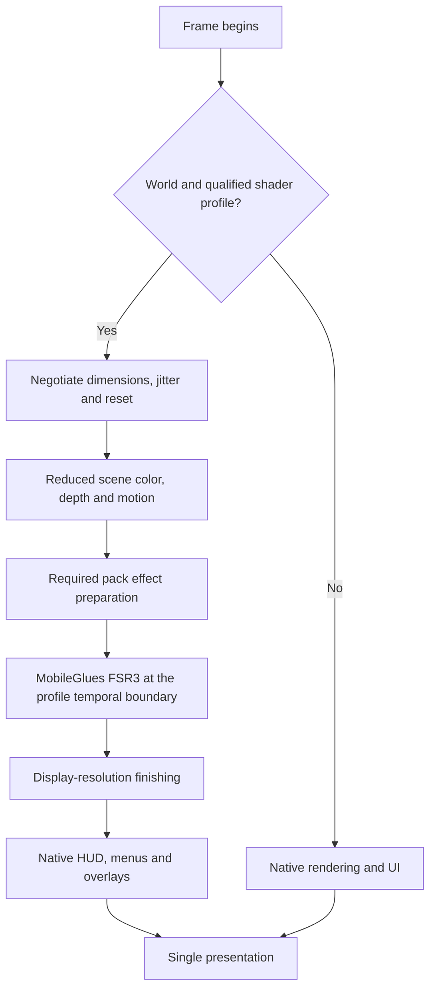

# MobileGlues FSR3 implementation handoff

**Immediate checkpoint after the NativeAA confirmation:** follow
[scaled-presets-prompts.md](scaled-presets-prompts.md) and
[the diagnostic contract](design/scaled-presets-diagnostic-contract.md).
Repair and qualify the scaled hand/light-shadow path with history off and
motion zero before resuming the temporal work below. The newer
[NativeAA evidence](validation/2026-10-20-x1e-nativeaa-final-pass.md) supersedes
the older package identities below as the current visual baseline.

This handoff is for the agent continuing the real MobileGlues and Minecraft/Iris
implementation after the 20 October in-game test. The outcome is useful FSR3
upscaling with shaders enabled, correctly sized menus/HUD/overlays and stable
world rendering. Compilation, dispatch success, an FPS overlay or camera-only
motion alone cannot close the work.

Start with [the main copy-ready prompt](agent-prompts.md#main-implementation-prompt).
The [follow-up review](audits/2026-10-20-followup-review.md) contains current
findings and evidence limits. [Implementation notes](implementation-notes.md)
contain design examples; [references](references.md) records the web sources.
The existing [task ledger](task-ledger.md) remains the only live work ledger.

## Required product boundary

Deliver Minecraft 1.21.1 / NeoForge 21.1.262 / Java 21 / Iris
1.8.14-beta.1 / Sodium 0.8.13 on the HP X1E Googlebook, using MobileGlues
over the actual system GLES provider. NeoForge 21.1.264, Minecraft 26.3 and
legacy 1.20.1 are separate future work. Keep frame generation out of this task.

The user accepts a game bridge and asks for a standard FSR3 integration.
The bridge may use targeted Minecraft/Iris/Sodium hooks and versioned pack
transformations. Keep the algorithm and GPU histories in MobileGlues. A
maintained Minecraft source fork is not required by this design, but meaningful
runtime renderer integration is required.

Shaders stay enabled in acceptance runs. Start reproduction with the recorded
AuroraLumen-Mobile-v2 pack, then qualify original Complementary Reimagined and
Unbound r5.9.3, retaining r5.9.2 regression. Audit a separate temporal profile
for each supported pack generation. Unknown packs retain their enabled shader
effects at native resolution until a compatible profile is qualified.
Generic import/render compatibility and qualified FSR3 support are distinct.

## Read and identify before editing

Read `AGENTS.md`, the three Googlebook architecture/plan/validation baseline
documents, `docs/MobileGlues_FSR3_Research_and_Implementation_Plan.md`, and
`docs/fsr3/{execution-state,task-ledger,frame-contract,decisions}.md`.
Read the new review plus `audits/minecraft-iris-pass-input.md` and the game,
backend-smoke and timing records under `validation/`.

Record HEAD, dirty paths, core/plugin/bridge source revisions and actual
artifact hashes. The review began at `d72acc0` and reconciled concurrent
changes through `5d7ac39`; recheck each
finding before changing it. Keep user changes and other agents' in-progress
edits intact. Claim ownership of shared files before concurrent work.

The later recorded R7/R4 package has APK
`3169ff55713ec8bab1cc20c52227c3c6754190c1eb309d823c5c64b33c392eb0`,
core `4ceefb43035e5853d85380d8f9556a078fe50441d32362a9ab340fbf73e17d56`,
and bridge `5c35d0ca2c0536a3319f65688212ce8f3aa072fcc65fc4bf40426ec82ed87c06`.
These are recorded identities, not a live verification by this review.
That run confirms camera activation with paired double-position JNI.
The later overlay record has limited visual evidence and does not verify
the FSR setting; its viewport-uniform JAR was not installed. Resolve the
actual installed tuple before any new comparison. Never mix the new
helper/JAR with an older core without an explicit compatible handshake.

## Intended frame flow



Route selection occurs before scene resources/projection are used. A later
failure uses a prepared compatible spatial/native fallback and restores the
next frame's AA/jitter policy. Missing submit must not enable the diagnostic
post-HUD path.

## Implementation sequence in the existing ledger

### 1. Stabilize routing, protocol and diagnostics

Scope: S3-A, S4-A and S1-C.

- Separate developer direct-present diagnostics from product FSR3. Menus,
  loading screens and shader-reload transitions use native rendering.
- Introduce explicit per-stream frame ownership. Every world frame has one
  scene submit and at most one reconstruction; every UI-only frame has none.
- Negotiate bridge protocol and capabilities before resolving typed calls.
  Require paired core/helper/JAR identities and reject mixed versions safely.
- Finish full-operation state/error isolation and dimension-valid fallback.
  Recheck the concurrent camera-continuity fix and recovery after invalidation.
- Make Off and unsupported profiles avoid allocations, per-frame file writes
  and reconstruction. Diagnostics should be bounded and event-driven.
- Trace actual resource format, extent, active rectangle, producer stage and
  generation; log requested dimensions separately from observed dimensions.
- Replace the broad native-target viewport heuristic with explicit target
  roles. Preserve shadow/offscreen viewports and intentional subviewports;
  the follow-up review's F08 reproduces a regression in `5d7ac39`.

Exit evidence: host tests for continuity/failure/state, mixed-version rejection,
and shader-enabled device UI captures across title/world/menu transitions.
The GUI layout and input hitboxes must retain native logical sizing.

### 2. Establish an actual reduced world

Scope: S1-A/S1-B and S4-B.

Give world color, sampleable depth, pre-hand/pre-translucent depth copies and
screen-space histories explicit ownership. Fix viewport/scissor, shader
dimensions, texture coordinates, copies and compute dispatches together.
Keep native main/UI targets separate. Identify fixed shadow/volume/LUT
resources so they are not accidentally scaled.

Prove the path using bilinear or the corrected FSR1 flow first. This isolates
resolution bugs from temporal reconstruction. Its AA/jitter policy must be
valid for a spatial upscaler; do not pass an unresolved jittered scene to FSR1.
Keep shaders and the selected pack effects enabled.

Exit evidence: a per-pass resource trace at native/Quality/Performance and odd
window sizes; uncropped world; unchanged GUI sizing; no unintended resource
resize; measured reduction of actual scene work. Requested-size logs alone
cannot pass this checkpoint.

### 3. Integrate the temporal boundary and complete frame semantics

Scope: S2-A reconciliation, S3-A and S4-C.

Pass actual scene texture resources through the bridge instead of discovering
the currently bound final framebuffer. Supply actual projection, depth
convention, jitter, time delta, color/exposure convention and resource identity.
Validate the ABI fields against what the backend really supports.

For the first Complementary LDR profile, use the audited `composite6` boundary,
replace its final TAA resolve, and route FSR output to display-size
`composite7`/`final`. Resolve `colortex2` and FXAA dependencies explicitly.
Establish color encoding before advertising support. HDR after `composite1`
is a separately qualified profile, not an incidental extension.

Choose one global scene-jitter owner, remove duplicate/partial pack jitter,
and preserve independently needed lighting/reflection histories. Implement
current-to-previous motion for static terrain first, then independent rigid
objects, articulated models and deformation. Record coverage; camera-only
remains experimental until the later content tests pass.

Exit evidence: debug color/depth/motion/jitter/mask captures, sign/scale tests,
multiple-frame convergence, cuts and disocclusions, and correct finishing/UI.

### 4. Qualify shaderpacks and moving content

Scope: S5-A and the existing project effect gates.

Create versioned runtime profiles keyed to original pack hashes and relevant
settings. Preserve original ZIPs. Verify entities, hands, sky, particles,
water, animated foliage and version-compatible Create geometry. Handle
reflection and texture-animation changes through tested motion/mask policies.
Do not claim all effects from one scene.

Keep ACT/WSR histories and voxel resources distinct from FSR histories.
Qualify the project's required effect tiers without disabling effects to
manufacture FPS gains. If a pre-existing provider/resource limit blocks an
effect, keep that gate open and report its exact constraint.

Exit evidence: shader-enabled motion clips and regional comparisons for every
claimed pack/effect profile, including r5.9.2 regression.

### 5. Meet an explicit performance budget

Scope: S3-A optimization and S6-A.

First replace blocking/unchecked timing with valid asynchronous measurement.
Measure the complete bridge+FSR+copy cost and its individual stages. Use
matched scene routes to determine how much GPU work scene scaling saves.

```text
available reconstruction budget
  = native GPU time
  - reduced-scene GPU time before reconstruction
  - finishing/copy overhead
  - required GPU margin
```

This is a budget calculation, not a prediction from panel resolution or FPS
screenshots. CPU-limited scenes may not improve when GPU work decreases.

Investigate PrepareReactivity/Accumulate, widened intermediate formats, copies,
clears, binding queries and barriers. Change one factor per experiment and
check numerical/image behavior against the pinned independent reference.
Do not remove synchronization or reduce precision by assumption.

Exit evidence: native, bilinear, FSR1 and FSR3 at matched settings; warmed
repeated runs; median/p95/p99 frame intervals; CPU/GPU stage costs; memory;
power/thermal behavior. Retain the plan's provisional 20% median improvement
goal in a GPU-limited route and its tail guard. A profile failing the goal
remains experimental with its measured tradeoff stated.

### 6. Package and qualify lifecycle

Scope: S6-B.

Exercise world/dimension switch, teleport, FOV/perspective changes, shader
reload, resizing, fullscreen/windowed transitions, background/resume, scale
changes, context/surface loss and name reuse. Retire resources in their owning
context. A global camera/cache/present flag must not cross streams.

Build one pinned core/plugin/helper/JAR tuple. Verify signatures, hashes, ELF
segment alignment, helper alignment and launcher-compatible native extraction.
The observed FCL packaging requirement is `extractNativeLibs=true`; verify the
actual launcher load path rather than applying a generic packaging recipe.
Install only the agreed tuple, preserve the previous known working artifacts,
and verify loaded hashes before the final shader-enabled game run.

## Device and collaboration boundaries

Use `adb -s C1L63708PZ` explicitly. Capture OS build, actual provider/driver,
launcher/runtime, core, helper, JAR, pack hash, settings and output extent for
each result. Device access has one owner at a time. Host work can continue
while a device session belongs to someone else.

Do not reboot, wipe, clear launcher data, replace the system graphics provider
or modify system/vendor partitions. Keep worlds and settings intact. Put
probe binaries in `/data/local/tmp` or app-owned storage. Only hashes of
original fixture archives belong in Git.

Use one agent sequentially by default. If the user explicitly assigns multiple
agents, split backend, bridge/profile and validation ownership and designate
one coordinator for ABI, CMake, EGL/framebuffer hooks and merges. The prompts
do not require spawning agents or messaging another chat.

## Required completion record

For each checkpoint, report changed files and revisions, commands and exit
codes, source/build/host/device evidence separately, remaining defects,
exact package/pack identities, and the next executable step. Update
`execution-state.md`, `task-ledger.md` and relevant decisions once evidence
supports the change. Reconcile stale PASS wording rather than leaving
contradictory tables. Keep semantic fixes, toolchain work and performance
experiments in separate commits; review only the intended staged paths.
