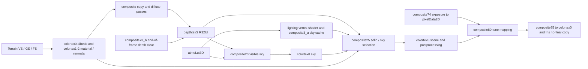

# iterationRP terrain-color and black-sky analysis

Date: 2026-10-20. Scope: source review, saved-evidence review and offline probes.
No renderer, bridge, shaderpack or device changes were made for this report.

**Conclusion:** iterationRP passes the recorded load/compile gate but still fails
visual correctness. The existing evidence does not identify one proven GPU root
cause. The next useful investigation is the **depth classification and resource
bindings at the lighting/presentation boundaries**, followed by terrain sampling
and atmosphere sampling according to the first incorrect intermediate result.
There are also two concrete findings that the previous audits missed: a
geometry-output lifetime hazard in the original pack, and an image-binding
replay collision in MobileGlues. Their contribution to this particular frame
requires target evidence.

The FSR no-final-pass presentation issue has a separate recorded fix. It should
not be reopened as the explanation for the remaining colors without new evidence.

## Evidence boundary and reproducibility

| Item | Reviewed identity / evidence |
| --- | --- |
| MobileGlues code | `d577a3ee82a8b80c795769bf0ff7a57266b00173`; unchanged product code at `96716e1a59994f7ba0d4c478e40df88482169727`, which adds the latest red/green audit |
| Original pack | `references/iterationRP Alpha 0.8.31.zip`, SHA-256 `334d0b0dadb5e2b927b992f2b93596c4cc1a518305c1e2a9b175c754a4d946e8` |
| Iris artifact inspected | `/home/polar/MobileGlues-fixtures/target-1.21.1-neoforge/iris-neoforge-1.8.14-beta.1+mc1.21.1.jar`, SHA-256 `60d5f8bf52f25e9986440f4a4270a6bd986d9cff994510e1108ac1547063b314` |
| Delivery lane | Minecraft 1.21.1, NeoForge 21.1.262, Java 21, Iris 1.8.14-beta.1+1.21.1-neoforge, Sodium 0.8.13-neoforge |
| Recorded target | HP Googlebook 14/quartz, serial `C1L63708PZ`, X1E80100/Adreno X1-85; Android 17/API 37, build `HP/quartz/quartz:17/CL3B.260622.276.R2/16560795:user/release-keys`; system ANGLE 2.1 over Vulkan 1.4.295, driver 512.886.6 |
| Runtime identity limitation | Target/provider information comes from the project/device records. This review did not query the device. Late screenshots are not all accompanied by complete installed-core/bridge/options manifests; source HEAD must not be substituted for their installed core hashes. |
| Offline results | [results.json](evidence/2026-10-20-iterationrp-review/results.json), generated by [reproduce.py](evidence/2026-10-20-iterationrp-review/reproduce.py) |

Shader references below use **original ZIP member paths and one-based lines**,
relative to `shaders/`. Text was extracted privately under
`/tmp/mg-iterationrp-review-20261020/original/`; the archive was unchanged. Private
X1E ports are not correctness references. The repository receives analysis,
hashes and independently written diagnostic code, not redistributed pack source.

Saved screenshots `/tmp/itrp-redgreen.png`, `/tmp/itrp-manualexp.png` and
`/tmp/itrp-g10-full.png` were inspected. In each 2880×1800 PNG, the terrain box
`[800,1300,1300,1600)` contains RGB `(221,94,71)` in **99.8733%** of its pixels;
the sky box `[650,350,1300,650)` is **100% black**. These are specified regions,
not whole-frame statistics. Geometry silhouettes and textured HUD items remain
visible. This supports a severe scene-data/shading failure; a constant exposure
multiplier alone is not a sufficient diagnosis. The user's green-terrain
observation remains part of the symptom report; these three captures do not
establish how the green state relates to time, options or camera orientation.

The [S0 record](../../validation/2026-10-20-iterationrp-original-s0.md) reports
the color problem with FSR disabled as well as NativeAA. The newer
[G10 receipt](../../validation/2026-10-20-g10-no-final-guard.md) records full-frame
presentation with the original pack after the guard, core `c741b74d…` and bridge
`cf29e0b8…`, while colors remain wrong. Its screenshot hash matches the reviewed
file. **S0 remains recorded PASS; S1 remains FAIL; no support level is promoted.**

## The relevant render graph

The visible sky and the cached `skyBox2D` are different outputs. A black visible
sky does not, by itself, prove the custom sky image or the atmosphere LUT is bad.



| Boundary | Original source and contract |
| --- | --- |
| Terrain attributes → G-buffer | `Lib/Programs/Gbuffers/Terrain_GS.glsl:64–91`; `Terrain_FS.glsl:109–221,399–427,451–452,573–577`. Default anisotropic quality is 4, texture-resolution inference is enabled, and parallax mode is 0 (`Lib/Settings.glsl:375–382`). Albedo is atlas RGB multiplied by vertex color; material/lightmap values are packed into normalized 16-bit channels. |
| G-buffer → copied scene depth | `Lib/Programs/Gbuffers/Composite_Copy_CS.glsl:28–79`: writes bit-cast solid depth to `img_depthtexS` only where scene depth is below 1.0. |
| Depth reset for following frame | `composite73_b.csh` → `Lib/Programs/Composite/Image_Clear_Screen_CS.glsl:16–30`: writes `floatBitsToUint(1.0)` to `depthtexS`, and a different sentinel to `waterDepth2D`. This is a shader write, not an automatic per-frame zero clear. |
| Visible sky | `composite20.fsh` → `Lib/Programs/Composite/Sky_Overworld_FS.glsl:70–78,117–119,169`: decodes `depthtexS`; discards when depth is below 1.0; otherwise computes atmospheric sky into colortex8. |
| Solid/sky composition | `composite25.fsh` → `Lib/Programs/Composite/Soild_FS.glsl:534–545,802–803,841–846`: solid pixels use G-buffer lighting/albedo; sky pixels copy colortex8 into colortex6. `Soild` is the actual source filename. |
| Atmosphere and sky cache | `shaders.properties:403`; `Lib/Programs/Composite/Overworld_VS.glsl:75–105`; `SkyImage_CS.glsl:74–108`. The LUT feeds visible sky and sunlight/skylight. `composite3_a.csh` writes the separate cached sky image. |
| Exposure → tone mapping | `composite74.csh` → `Exposure_CS.glsl:28–30,184–206`; `composite80.fsh` → `Final_FS.glsl:211–212,507–511,534–546,572`. The final pass always reads the exposure image, including manual exposure. |
| Presentation | `composite85.fsh` → `Final_FS.glsl:827,852–861,1234`; there is no root `final.fsh`/`final.vsh`. Logical colortex names can represent different ping-pong textures; compare actual object IDs before declaring feedback. |

## Findings

### F1 — Depth classification is the first black-sky discriminator

**Confidence:** high in the source dependency; unproven runtime failure.

At a background pixel, `depthtexS` must contain unsigned bits **`0x3f800000`**,
which decode to floating-point 1.0. Zero, a stale terrain depth, or the wrong
resource at its sampler causes `Sky_Overworld_FS` to discard the sky. The solid
pass then follows the terrain branch and reads material data at a background
pixel. This can explain a black sky without any failure in the atmosphere LUT.
It is also compatible with widespread scene corruption if the image-unit
contract is wrong.

The image is declared `clear=false` (`shaders.properties:387`). This is intentional
retention, not proof of a missing initialization bug: the pack provides its own
end-of-frame writer. Iris documents `false` as retaining image data between
frames. Blanket zero-clearing custom images would destroy this depth sentinel
and other temporal state. [Iris custom-image contract](https://shaders.properties/current/reference/buffers/custom_images/)

Capture the same sky pixel after `composite73_b`, before `composite20` in the
next frame, and after the initial copy pass. Record unsigned bits and decoded
float, not an RGB visualization alone. Also capture `depthtex0`. If the native
depth says sky and the copied depth does not, investigate the clear/copy/image
mapping before changing atmospheric math. Observe frame 1 separately and then
several settled frames; persistence after frame 2 needs more than a first-frame
initialization explanation.

### F2 — Correct sampler and framebuffer identities remain unproved

**Confidence:** high that the evidence is missing; medium as a common cause.

IterationRP stores encoded normals in colortex2 and packed materials in
colortex1, while colortex6 carries scene color. A wrong sampler assignment,
stale DSA bind, wrong ping-pong side, or framebuffer attachment alias could expose
data buffers as scene color. The reported red/green terrain and black background
are compatible with this, but their appearance alone does not identify a normal
buffer.

Inspect both mappings at the draw/dispatch boundary:

1. **Sampler:** program/stage/name → uniform value → texture unit → target,
   object, level, dimensions, format, swizzle and sampler object.
2. **Image:** name/location → application unit → emitted ESSL binding → actual
   driver image unit → object, level/layer, access and format.

The core keeps image mappings in
[`image_bindings.cpp`](../../../../MobileGlues-cpp/gl/image_bindings.cpp), especially
lines 368–394; sampler units are a different namespace. Do not infer the sampler
mapping from image-bind logs. The DSA texture bind is in
[`DSAWrapper.cpp`](../../../../MobileGlues-cpp/gl/ExtWrappers/DSAWrapper.cpp):1268–1339.
Its diagnostic is logged once per object/unit combination; it is not a snapshot
of a particular failing pass.

Compare the actual colortex6 read texture and draw attachment at composite25 and
composite80. The same logical name in GLSL is not evidence of a feedback loop;
the same actual object/level used incompatibly would be. The new
[red/green audit](2026-10-20-iterationrp-redgreen-audit.md) correctly raises this
path, but its "exonerated" wording for attachment widening/feedback is stronger
than the retained per-pass evidence supports.

### F3 — Original terrain geometry shader leaves a sampling input undefined

**Confidence:** confirmed source portability hazard; device contribution unknown.

`Terrain_GS.glsl:64–74` assigns the flat output `v_textureResolution` before its
three-vertex emission loop. Lines 78–91 assign the other terrain outputs on each
iteration but never reassign this output. In the optional parallax branch,
`v_quadCoordMapping` and `v_quadCoordScale` have the same lifetime problem.

Both desktop GLSL and ESSL make geometry output values undefined after
`EmitVertex`. A driver that retains them may make the pack appear to work, but
that retention is not a portable requirement. [Desktop GLSL 4.60 §8.13](https://registry.khronos.org/OpenGL/specs/gl/GLSLangSpec.4.60.html#geometry-shader-functions),
[ESSL 3.20 §8.13](https://registry.khronos.org/OpenGL/specs/es/3.2/GLSL_ES_Specification_3.20.html#geometry-shader-functions)

The default fragment anisotropic function uses this input for atlas tile size,
derivatives and mip selection (`Terrain_FS.glsl:109–130,145–149`). Undefined or
zero values can invalidate these calculations. This is a specific route to flat
or incorrect terrain albedo. **It cannot independently explain the visible-sky
failure**, which uses a different vertex/fragment path.

A bounded standalone compile of the expanded original geometry source succeeded
after applying the actual MobileGlues constant-transpose helper. SPIR-V contains
two stores to `v_textureResolution` before the emission loop and none after the
loop header. The [evidence](evidence/2026-10-20-iterationrp-review/results.json)
records compiler version, hashes and preparation. This was desktop SPIR-V
inspection, not the full Iris/Sodium → MobileGlues ESSL → ANGLE pipeline.

The diagnostic order is: inspect colortex0 immediately after terrain; if already
bad, test the original pack's `ANISOTROPIC_FILTERING_QUALITY=0` option with
parallax still off. Improvement would implicate that sampling path, not yet
distinguish the GS output from fragment anisotropic arithmetic. Inspect the
actual translated geometry output and compare a minimal per-vertex assignment
probe before choosing a compatibility change. The portable pattern is:

```glsl
// Illustrative pattern, independently written; not a patch to the ZIP.
float primitiveTextureSize = calculateTextureSize();
for (int vertex = 0; vertex < 3; ++vertex) {
    copyVertexInputs(vertex);
    textureSizeForFragment = primitiveTextureSize;
    EmitVertex();
}
EndPrimitive();
```

An opt-in shader compatibility transform would need bounded matching and
regression evidence. A modified private pack can isolate this issue but cannot
close the original-archive support gate.

### F4 — Manual exposure did not bypass the image path

**Confidence:** confirmed correction to the earlier diagnosis.

The [visual audit](2026-10-20-iterationrp-visual-audit.md):71–77 says the manual
exposure observation exonerates the `pixelData2D` exposure scalar. The original
source does not support that conclusion:

- Manual mode changes the calculation in `Exposure_CS.glsl:28–30`.
- The value still passes through `imageStore(img_pixelData2D, ...)` at line 206.
- `Final_FS.glsl:211–212,542` still fetches `(0,0).y` and multiplies scene color
  by it. There is no manual-mode bypass in that consumer.

Thus a lost dispatch, incorrect image/sampler binding, visibility failure or
wrong channel content can survive the manual-exposure option. The observation
weakens an auto-exposure adaptation/formula explanation only if the option was
active and the expected value reached the consumer. The recorded test also
changed `SUNLIGHT_LEAK_FIX`, so it is not a clean single-variable experiment.

At the pack's default manual `EV_VALUE=14`, the expected multiplier before
storage is **9.1552734375**, and a binary16 round-trip is **9.15625**. Read
`pixelData2D(0,0).y` after composite74 and again through composite80's sampler.
Check the actual selected EV before using this expected value. A finite correct
read at both boundaries is much stronger evidence than an unchanged screenshot.

### F5 — LUT bytes are healthy; GPU consumption still needs proof

**Confidence:** confirmed CPU asset result; GPU upload/sample contents unknown.

The original LUT contains **17,301,504 bytes**, exactly `512×128×33×4×2`.
Its member SHA-256 is
`282826edfb4f216a0a90bb49b4780da5c38bfdf880d8e03d6ed3da168a309de4`.
Decoding little-endian binary16 gives **8,650,752 finite components**, no negative
values, 6,769,686 nonzero components, and range **0 to 3.0390625**.

| Texel `(x,y,z)` | Expected RGBA, decoded from original bytes |
| --- | --- |
| `(0,0,0)` | `(0,0,0,0)` — legitimate zero control |
| `(511,127,31)` | `(1.2158203125,1.6474609375,2.73046875,0.0831298828125)` |
| `(0,0,32)` | `(0.90234375,0.86328125,0.76220703125,0)` |
| `(128,32,32)` | `(0.431396484375,0.390869140625,0.339111328125,0)` |
| `(32,72,32)` | `(0.0010766983032226562,0.002071380615234375,0.0050811767578125,0)` |
| `(63,79,32)` | `(0.000004947185516357422,0.000009715557098388672,0.000024497509002685547,0)` |

`PrecomputedAtmosphere.glsl:1–14,197–202,256–293` places scattering in the first
32 slices and transmittance/irradiance regions in slice 32. Arbitrary samples can
legitimately be zero; three zero matches would be a poor upload test. Check
several nonzero regions, including values above 1 and small values.

The latest upload receipt shows the expected driver call and texture parameters.
That narrows the investigation but does not establish post-call data, the
draw-time sampler object, or the lookup coordinates. A bound sampler object can
override the texture's sampling state; capture it alongside the texture.
[OpenGL ES 3.2 §8.2](https://registry.khronos.org/OpenGL/specs/es/3.2/es_spec_3.2.pdf#page=158)

There is also a practical blocker in the previously suggested readback:
[`DSAWrapper.cpp`](../../../../MobileGlues-cpp/gl/ExtWrappers/DSAWrapper.cpp):1496–1535
**rejects `glGetTextureImage` for a 3D target**. Use a controlled sampler3D → SSBO
probe or supported per-layer framebuffer readback; do not interpret an untouched
CPU destination as a black LUT. Identify the resource by active program/name,
target and dimensions, not the previous run's texture number `109`.

Example probe body for a future diagnostic program:

```glsl
#version 310 es
precision highp float;
precision highp int;
layout(local_size_x=1) in;
uniform highp sampler3D lut;
layout(std430, binding=0) buffer ProbeResults { vec4 samples[6]; };
const ivec3 coords[6] = ivec3[6](
    ivec3(0,0,0), ivec3(511,127,31), ivec3(0,0,32),
    ivec3(128,32,32), ivec3(32,72,32), ivec3(63,79,32));
void main() {
    for (int i=0; i<6; ++i) samples[i] = texelFetch(lut, coords[i], 0);
}
```

The host harness must validate the texture dimensions, explicitly select the
sampler unit, preserve/restore program, texture/sampler bindings and SSBO
binding/range, check errors, and fence completion before CPU reading. Restore
the pack's binding 0 SSBO; it contains live frame data. The snippet passes
standalone glslang syntax validation; it has not been executed on the GPU. If texel fetches match, test
filtered lookups and then the pack's actual coordinates, sun direction,
projection inputs and finite radiance. Uploading the LUT again is not the next
useful action when those boundaries remain unobserved.

### F6 — MobileGlues image replay can overwrite an active mapping

**Confidence:** reproduced backend state defect; lower causal confidence here.

[`drawing.cpp`](../../../../MobileGlues-cpp/gl/drawing.cpp):283–307 loops over all
remembered logical image bindings. A unit absent from the current program's map
keeps its numeric identity. That can collide with a mapped active unit:

```text
Current program: logical image 0 -> physical image 2
Logical binding 0 = texture 101; stale inactive logical binding 2 = texture 202
Replay: bind physical 2 to 101, then bind physical 2 to 202
Expected active texture: 101. Observed by the host driver double: 202.
```

The reproduction compiles the **verbatim current function**, extracted from
`drawing.cpp`, with minimal state/driver doubles. It demonstrates the collision
in actual control flow without claiming GPU execution. The replay also marks
its shadow valid immediately after a bind, unlike the error-aware public bind
path at lines 349–364. That asymmetry deserves a rejected-bind regression case.

This is not enough to assign the iterationRP failure to replay. `javap` of the
pinned Iris JAR shows `ComputeProgram.use()` selects the program, updates
uniforms/samplers, then calls `ProgramImages.update()`. That update initializes
image uniforms and subsequently rebinds every active `ImageBinding`. The host
probe confirms an explicit active rebind restores the intended texture. Also,
`prepareForDraw()` at `drawing.cpp:203–217` does not replay images after that
repair. Capture the binding **at dispatch**, not just during program selection.

Future repair should materialize only the current program's authoritative active
mapping, handle valid aliases/unbinds, and preserve errors/cache validity. Do not
equate unique emitted image units with proof of correct runtime texture objects.

### F7 — Legal float backings are not full normalized-format emulation

**Confidence:** confirmed semantic limitation; low as the sole explanation.

[`texture.cpp`](../../../../MobileGlues-cpp/gl/texture.cpp):541–553,1064–1074,1275–1283
widens null-allocated RGBA16/RG16 to RGBA32F. The matching
[`compat_image.cpp`](../../../../MobileGlues-cpp/gl/glsl/compat_image.cpp):43–80
rewrites image qualifiers, including a name-based `colorimg8` exception.
This allows legal image operations but does not reproduce normalized-integer
clamping/quantization, dropped channels or every upload/allocation path. No
store-value conversion is added by that qualifier rewrite. Correct format logs
therefore close a narrower gate than full desktop format semantics.

For this pack, `Utilities.glsl:158–190` packs integer codes as `n/65535` and
decodes them by multiplying and truncating. The offline CPU check recovered all
65,536 codes through float32, but lost **60,415** through a binary16 intermediate.
This supports the choice of float32 over float16 for packed data; it does not
validate GPU sampler precision, G-buffer contents, or normalized behavior for
arbitrary values. Keep geometry/material/data samplers at adequate precision
in the generated ESSL and test representative packed codes through actual
attachment → image → sampler paths.

The recorded provider exposes float-linear and norm16 texture extensions, so
"Android cannot sample these formats" is not a sufficiently specific diagnosis.
Use actual source metadata and target probes. A global RGBA16F substitution, a
name-only format guess, or suppressing a validation error would weaken fidelity.

## Recommended next diagnostic run

This is a plan for the device owner/next implementation turn. It was not run here.
Keep the original ZIP, shader effects enabled, current no-final guard and a
native-size scene while isolating color correctness. Record exact hashes of the
installed core, FSR bridge and any image-metadata bridge, or record absence.
Also record pack options, resource pack, dimension/time/weather, viewport and
the actual provider/OS tuple. Restore a single known option set between controls.

| Order | Bounded observation | Decision it supports |
| ---: | --- | --- |
| 1 | Same terrain and sky pixels: native depth, typed `depthtexS`, colortex0/1/2 immediately after terrain/copy; record per-pass texture IDs. | Bad colortex0 starts the GS/atlas/anisotropic investigation. Bad depth sentinel starts clear/image/binding investigation. |
| 2 | Before/after composite20 and composite25: depth branch, colortex8 sky, colortex6 scene, read/draw flip sides and sampler/image mappings. | Distinguishes skipped sky, bad atmosphere output, incorrect lighting and data-buffer aliasing. |
| 3 | LUT probe above, `skyBox2D` after composite3_a, sun/skylight inputs, finite values and actual lookup coordinates. | Separates uploaded asset data from sky-cache writes and shader math/uniform inputs. |
| 4 | After composite74 and before/after composite80: exposure `(0,0).y`, scene RGB and tone-mapped RGB; composite85 input/output and no-final copy. | Finds exposure/postprocessing/presentation corruption if earlier scene data is correct. |
| 5 | If terrain albedo is already wrong, change only anisotropic quality to 0; inspect the real translated GS and fragment sampling inputs. | Isolates the default terrain texture-sampling path without replacing the pack. |
| 6 | Minimal wrapper regressions for stale image replay, manual exposure producer/consumer, depth sentinel and packed16 round-trips. | Gives each proposed core fix an independent correctness oracle. |

Capture image writes and barriers in their original ordering. The core forwards
`glMemoryBarrier` (`drawing.cpp:493–497`); the pinned Iris compute dispatch contains
a barrier mask `8232` (`0x2028`, image access, texture fetch, SSBO) unless its
concurrent-compute path suppresses it. Presence of that code does not prove the
specific failing transition is synchronized. For an image-write → sampler-read
transition, verify the texture-fetch barrier at that boundary. Any extra-barrier
control must be labelled as a separate experiment because it can mask the bug.
[OpenGL ES 3.2 §7.11](https://registry.khronos.org/OpenGL/specs/es/3.2/es_spec_3.2.pdf#page=141)

For a 2880×1585 scene with pack scaling off, composite73_b's 16×8 local size
implies 180×199 workgroups; default 64-pixel sky faces imply a 192×128 cache and
12×16 workgroups for composite3_a. Derive expectations again if options or scene
dimensions change. Look at settled frames as well as first-frame state; do not
fix persistent images by indiscriminately clearing them each frame.

A correctness fix is accepted when the **original** archive produces textured
terrain, the intended sky and lighting, stable camera motion, correct HUD,
reload/resize/world re-entry, and no relevant GL errors on the target tuple.
Then run the effect matrix and performance work. Preserve the existing FSR
baseline while qualifying this different shaderpack graph.

## Checks completed in this review

- Original ZIP and selected shader-member hashes verified; atmosphere data
  decoded and sampled on CPU.
- Three saved screenshots inspected and specified pixel-region statistics
  recorded, with file hashes in `results.json`.
- Source-extracted image replay collision reproduced; explicit rebind recovery
  also recorded, to avoid overstating its runtime relevance.
- Original geometry source inspected through a bounded glslang/SPIR-V probe;
  no claim of target shader execution.
- Proposed LUT compute snippet passes `glslangValidator -S comp` syntax
  validation; no GPU execution or readback was performed.
- `sh MobileGlues-cpp/tests/run.sh` passed, exit 0. Its current coverage does not
  establish iterationRP visual correctness or cover the stale-binding scenario.
  Retained host log: [host-suite.log](evidence/2026-10-20-iterationrp-review/host-suite.log),
  SHA-256 `1feb83c2283fcce5d564de9ec1f265bed77d0bc965bd526a464aa4f986fc7a0a`.
- No ADB commands, installation, game settings changes, renderer/bridge fixes,
  shader ZIP modifications, commits or pushes were performed by this review.

Reproduction uses the bundled Python with NumPy/Pillow, plus `g++`,
`glslangValidator` and `spirv-dis`:

```sh
/home/polar/.cache/codex-runtimes/codex-primary-runtime/dependencies/python/bin/python3 \
  docs/mobileglues-googlebook/shaderpack-support/audits/evidence/2026-10-20-iterationrp-review/reproduce.py \
  --repo /home/polar/MobileGlues --geometry \
  --capture /tmp/itrp-redgreen.png \
  --capture /tmp/itrp-manualexp.png \
  --capture /tmp/itrp-g10-full.png > /tmp/iterationrp-review-rerun.json
```

Capture arguments are optional if the temporary screenshots are no longer
available. Generated full shader sources and SPIR-V remain temporary; no pack
source is added to Git. Retain this dated result when investigating newer code.

## References and prior evidence

- [Iris custom images](https://shaders.properties/current/reference/buffers/custom_images/): image/sampler naming and retention semantics; current documentation, not a replacement for the pinned JAR.
- [Iris custom textures](https://shaders.properties/current/reference/buffers/custom_textures/): custom texture resource declarations.
- [OpenGL ES 3.2 API specification](https://registry.khronos.org/OpenGL/specs/es/3.2/es_spec_3.2.pdf): sampler state, shader-memory visibility and texture/image contracts.
- [ESSL 3.20 specification](https://registry.khronos.org/OpenGL/specs/es/3.2/GLSL_ES_Specification_3.20.html): geometry output lifetime and sampler type/precision requirements.
- [Desktop GLSL 4.60 specification](https://registry.khronos.org/OpenGL/specs/gl/GLSLangSpec.4.60.html): the corresponding geometry-output rule is also present on desktop.
- [Original-pack static audit](2026-10-20-iterationrp-static-audit.md), [visual audit](2026-10-20-iterationrp-visual-audit.md), [latest red/green audit](2026-10-20-iterationrp-redgreen-audit.md): historical findings, refined above rather than treated as proof of exclusion.
- [G1 legalization record](../../validation/2026-10-20-g1-rg16f-rg32f-lowering.md), [G10 presentation record](../../validation/2026-10-20-g10-no-final-guard.md), [provider capability record](../../validation/2026-10-19-x1e-iterationrp-caps.json): distinct host/provider/game evidence levels.
